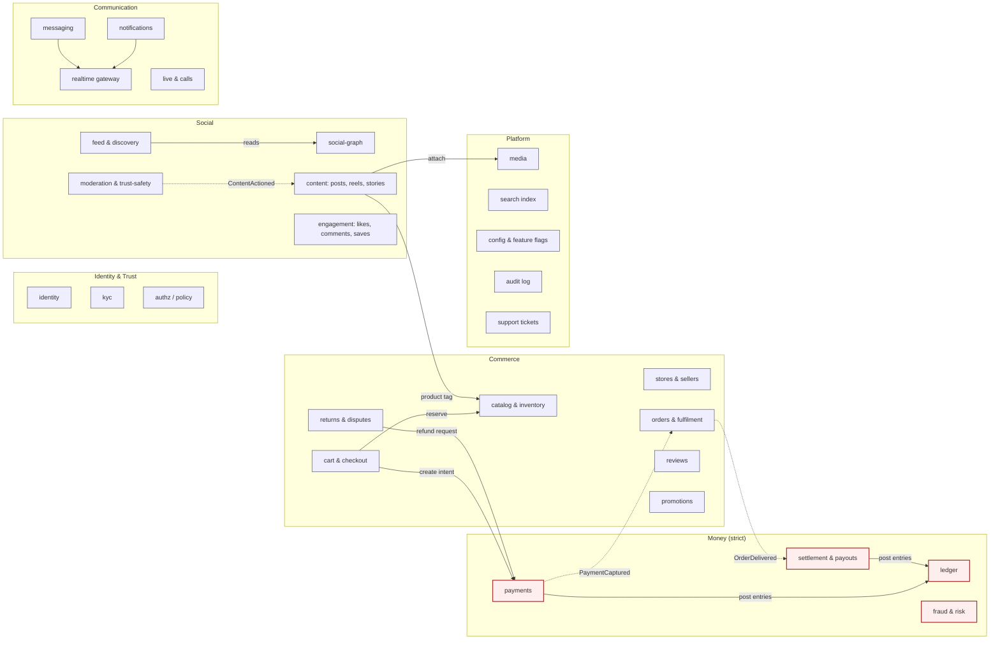
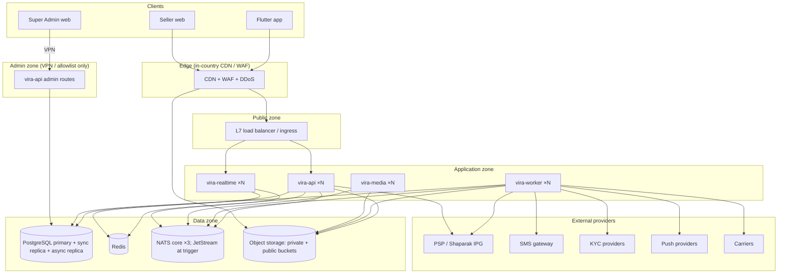
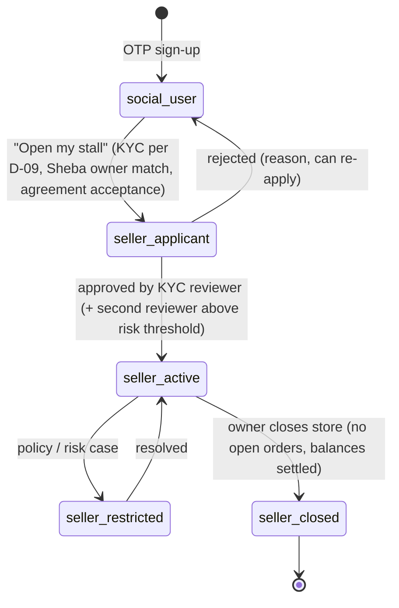

# 04 — System and Domain Architecture

**Status:** Phase 0 v3 (final for owner acceptance; v2/v3 additions marked) · Decisions referenced as ADR-xxx are in doc 05.

## 1. Architectural style (summary)

**A modular monolith in Go, with a small number of separately deployed runtimes where the workload is physically different** (ADR-001):

| Deployable | Built from | Why separate |
|---|---|---|
| `vira-api` | monolith | All synchronous HTTP for mobile and Seller web |
| `vira-admin-api` | monolith repo, separate `main` | Super Admin HTTP only; admin routes do not exist in the public binary (audit F-20) |
| `vira-worker` | **same** monolith binary, worker mode | Background jobs, outbox relay, schedulers, reconciliation |
| `vira-realtime` | monolith repo, separate `main` | Long-lived WebSocket connections; scales on connection count, not CPU |
| `vira-media` | monolith repo, separate `main` + FFmpeg/libvips | CPU/GPU-heavy transcoding; must never starve API |
| `vira-admin-web`, `vira-seller-web` | React + TypeScript SPAs | Static assets served from origin/CDN; talk only to `vira-api` |
| `vira-mobile` | Flutter | Android/iOS |
| SFU / live ingest | Off-the-shelf (LiveKit / SRS class, ADR-010) | Media plane; Phase 8 |

One codebase, one primary database cluster. Asynchronous work at Tier A uses a single PostgreSQL outbox plus a PostgreSQL job queue; **core NATS** provides realtime pub/sub; **NATS JetStream is adopted when a measured trigger is hit** (§9, ADR-006 as amended). Modules communicate through **in-process interfaces** and **domain events via a transactional outbox**, never by reading each other’s tables. This preserves the option to extract any module into a service later without a rewrite.

## 2. Bounded contexts and modules

Solid arrow = synchronous in-process call through the owning module’s public interface. Dotted = asynchronous domain event.

### 2.1 Module catalogue

| Module | Owns (tables / state) | Public interface (examples) | Emits | Consumes |
|---|---|---|---|---|
| identity | users, phone_identities, sessions, devices, otp_challenges, account_status | `Authenticate`, `RevokeSession`, `GetUser` | `UserRegistered`, `SessionRevoked`, `AccountDeleted` | — |
| kyc | kyc_profiles, kyc_cases, kyc_evidence (encrypted refs), kyc_levels | `GetLevel(userID)`, `SubmitEvidence` | `KycLevelChanged` | `UserRegistered` |
| authz | roles, permissions, role_bindings (admin + seller staff) | `Can(subject, action, resource)` | `RoleBindingChanged` | — |
| social-graph | follows, follow_requests, blocks, mutes, close_friends | `Relationship(a,b)`, `IsBlocked` | `Followed`, `Blocked` | `AccountDeleted` |
| content | posts, reels, stories, highlights, product_tags, mentions, hashtags | `Publish`, `GetPost` | `PostPublished`, `PostRemoved` | `MediaReady`, `ContentActioned` |
| engagement | reactions, comments, saves, collections, counters | `Like`, `Comment` | `CommentCreated` | `PostRemoved` |
| feed & discovery | feed_items (fan-out cache), explore candidates | `HomeFeed`, `Explore` | — | `PostPublished`, `Followed` |
| moderation | reports, moderation_cases, actions, appeals, policy_versions | `Report`, `Decide`, `Appeal` | `ContentActioned`, `UserRestricted` | `PostPublished`, `MediaReady` |
| media | media_assets, variants, upload_sessions | `CreateUpload`, `Finalize` | `MediaReady`, `MediaRejected` | — |
| messaging | conversations, members, messages, receipts | `Send`, `History` | `MessageSent` | `Blocked` |
| realtime | in-memory connection registry (Redis presence) | — (WebSocket protocol) | `PresenceChanged` | `MessageSent`, `NotificationCreated` |
| notifications | notifications, preferences, push_tokens, delivery_attempts | `Notify` | `NotificationCreated` | most domain events |
| live & calls | live_sessions, live_products, call_sessions | `StartLive`, `PinProduct` | `LiveStarted`, `LiveEnded` | — |
| stores | stores, store_members, store_policies, shipping_profiles, seller_agreements | `GetStore`, `AddStaff` | `StoreActivated`, `StoreSuspended` | `KycLevelChanged` |
| catalog & inventory | categories, products, variants, inventory_levels, reservations, movements | `Reserve`, `Commit`, `Release` | `ProductPublished`, `StockLow` | `CheckoutExpired`, `OrderCancelled` |
| cart & checkout | carts, cart_items, checkout_sessions | `StartCheckout`, `PlaceOrder` | `CheckoutStarted`, `CheckoutExpired` | `PaymentCaptured`, `PaymentFailed` |
| orders & fulfilment | purchases, seller_orders, order_items, shipments, shipment_events | `ConfirmDelivery`, `Ship` | `OrderPlaced`, `OrderShipped`, `OrderDelivered`, `OrderCancelled` | `PaymentCaptured` |
| returns & disputes | return_requests, return_items, disputes, evidence | `RequestReturn`, `Decide` | `ReturnApproved`, `DisputeResolved` | `OrderDelivered` |
| reviews | reviews, review_media | `Submit` | `ReviewSubmitted` | `OrderDelivered` |
| promotions | coupons, redemptions, campaigns | `Quote` | — | — |
| payments | payment_intents, payment_attempts, psp_callbacks, refunds, psp_reports | `CreateIntent`, `HandleCallback`, `Refund` | `PaymentCaptured`, `PaymentFailed`, `RefundCompleted` | `ReturnApproved` |
| ledger | accounts, journal_entries, postings, balances | `Post(entry)` (only callers: payments, settlement, promotions-funding) | `JournalPosted` | — |
| settlement & payouts | payout_accounts (Sheba), holds, payout_requests, payout_batches | `RequestPayout`, `ApproveBatch` | `PayoutCompleted` | `OrderDelivered`, `ReturnApproved`, `ReturnWindowClosed` |
| fraud & risk | risk_signals, risk_scores, cases | `Assess(ctx)` | `RiskFlagged` | payment, payout, login events |
| search index | external index (OpenSearch, later) | `Search` | — | `ProductPublished`, `PostPublished`, `UserUpdated` |
| config & flags | flags, remote_config, app_versions | `IsEnabled`, `Get` | `FlagChanged` | — |
| audit | audit_events (append-only) | `Record` | — | admin & money events |
| support | tickets, ticket_messages, attachments | `Open`, `Reply` | `TicketOpened` | — |

### 2.2 Dependency rules (enforced in CI)

1. A module may import another module **only** through its `public` package; internal packages are invisible (Go `internal/` + architecture lint).
2. **No cross-module SQL.** Each module owns its own PostgreSQL schema; ownership is enforced by architecture lint and a CI check that every SQL statement in a module references only that module’s schema (the transaction scripts T1–T10 in doc 06 §5 are the registered exceptions). DB roles are per **runtime/access path**, not per module (doc 06 §1, audit F-03).
3. The **Money** modules (payments, ledger, settlement) may not import Social or Comms modules.
4. The ledger exposes **one write operation** — `Post(JournalEntry)` — and validates balance in the same DB transaction.
5. Cyclic module dependencies fail the build.

## 3. Consistency model

| Interaction | Mechanism | Consistency |
|---|---|---|
| Place order: cart → reserve stock → create purchase + seller orders → create payment intent | Single PostgreSQL transaction across `checkout`, `catalog`, `orders`, `payments` schemas via a coordinating application service | **Atomic** |
| Payment verified → ledger journal → intent status | Single transaction (`payments` + `ledger`) | **Atomic** |
| Payment captured → orders `PAID` → seller notified | Outbox event | Eventual (target < 2 s) |
| Delivered → settlement hold release date computed | Outbox event | Eventual |
| Refund approved → PSP/IBAN refund → ledger | Saga with persisted state machine; each step idempotent | Eventual, compensatable |
| Post published → feed fan-out, search index, moderation scan | Outbox events | Eventual |
| Message sent → delivery to online members | Commit to DB, then best-effort direct publish on core NATS `user.{id}` subjects; outbox only for push side-effects; clients gap-fetch by `seq` | At-least-once, client dedupe by `(conv, seq)` |

Cross-schema transactions are permitted **only** inside named “transaction scripts” listed in doc 06 §5. Any new one requires an ADR. When a module is extracted later, each such script becomes a saga; this list is the extraction cost register.

## 4. Runtime topology (MVP)

The Super Admin API is a **separate binary** (`vira-admin-api`) deployed only on the admin network (ADR-016), with a distinct auth realm, session store and DB role. A CI test and a production synthetic probe assert that `/admin/*` returns 404 on every public host.

## 5. Trust boundaries

| # | Boundary | Controls |
|---|---|---|
| TB1 | Internet → edge | WAF, rate limits, bot rules, TLS 1.2+ (1.3 preferred) |
| TB2 | Edge → API | mTLS or signed edge headers; API never trusts client IP headers except from edge |
| TB3 | Mobile app → API | Short-lived access token (JWT, 10 min) + rotating refresh token bound to device key |
| TB4 | Admin → admin API | VPN + device posture + WebAuthn/TOTP + short sessions + IP allowlist |
| TB5 | API → database | Per-module DB roles; RLS for seller-scoped tables |
| TB6 | Platform → PSP / KYC / SMS | Outbound allowlist; secrets from vault. PSP callbacks are typically **browser-mediated and unsigned**: treated as an untrusted hint, bound to the attempt by a server-generated nonce, and always confirmed by server-to-server verify/inquiry (doc 07 §4.3) |
| TB7 | User uploads → media pipeline | Quarantine bucket; type sniffing; size limits; re-encode; EXIF strip; malware scan for documents |
| TB8 | KYC evidence | Separate encrypted bucket + separate KMS key; access only via KYC module with audit |

## 6. Key data flows (overview — sequences in doc 07)

1. **OTP login:** app → `POST /v1/auth/otp` → rate-limit (phone, IP, device) → SMS provider → `POST /v1/auth/otp/verify` → session + device binding.
2. **Media upload:** app → `POST /v1/media/uploads` → pre-signed PUT to quarantine → `POST …/finalize` → `vira-media` validates/transcodes → public variants → `MediaReady`.
3. **Checkout:** cart → `POST /v1/checkout` (Idempotency-Key) → reservations + purchase + intent → PSP redirect → PSP callback → **server verify** → ledger posting → `PaymentCaptured`.
4. **Settlement:** `OrderDelivered` + return window closed → hold release → seller available balance → payout request → maker–checker batch → Paya file / PSP payout API → bank confirmation → ledger.
5. **Messaging:** app ↔ `vira-realtime` WebSocket; send via HTTP or socket → messaging module persists → best-effort publish on core NATS `user.{id}` subjects → gateways deliver to connected members → outbox → push for offline members; clients gap-fetch by `seq`.

## 7. Client architecture (Flutter)

| Layer | Choice |
|---|---|
| Structure | Feature-first packages mirroring backend modules; shared `core` (network, auth, l10n, design system) |
| State | Riverpod (or Bloc — ADR-013 leaves this to the mobile lead in Phase 1, with criteria) |
| Networking | Generated client from OpenAPI; interceptors for auth refresh, Idempotency-Key, retry with jitter on idempotent calls only |
| Offline | Local DB (Drift/SQLite) for drafts, outbox of user actions (likes, comments, messages) with client IDs; replay on reconnect (screens `_216`, `_217`) |
| Media | Native camera/editor plugins; resumable chunked upload; client-side compression before upload |
| Realtime | Single multiplexed WebSocket; exponential back-off; resume token |
| Security | Certificate pinning (with rotation plan), secure storage for refresh token, root/jailbreak signals as **risk input** not hard block |
| Payments | PSP page opened in the **system browser / in-app browser tab**, never an embedded WebView that can read card fields; return via app link |
| Localisation | `intl` with fa-IR; Jalali via a vetted package; Persian digits; `Directionality.rtl` root; bidi isolation for mixed strings |

## 8. Admin & seller web architecture

* React + TypeScript, Vite, TanStack Query, a headless component library with RTL support, generated API client.
* Super Admin and Seller Web are **separate apps** with separate origins, cookies and CSP; shared design-system package.
* All admin list views are server-paginated, filterable, and **every row read of PII is logged** (doc 08 §6).
* No admin action is performed by client-side logic alone: the server enforces RBAC, maker–checker and reason codes.

## 9. Evolution path

| Trigger (measured) | Action |
|---|---|
| Realtime connections > ~50k per node, or messaging writes > ~2k/s sustained | Move messages to a partitioned store (Postgres partitions first; ScyllaDB/Cassandra class only if still insufficient) |
| Feed fan-out latency SLO breached | Dedicated feed service with Redis-backed timelines and hybrid push/pull for high-follower accounts |
| Ledger write contention or audit requirement for separate custody | Extract `payments + ledger + settlement` to a separate service and separate DB cluster (first extraction candidate) |
| Search relevance or Persian morphology insufficient in Postgres | Introduce OpenSearch fed from outbox events (planned for Phase 4) |
| Outbox dispatch lag > 5 s p95, > ~500 events/s sustained, or a consumer needs replay/retention | Adopt NATS JetStream behind the existing outbox relay (no producer changes) |
| Team size > ~4 squads owning distinct modules | Consider extracting modules with independent release cadence |

## 10. Shared seller identity: “Manage My Stall” and Seller Admin web (v3, owner requirement)

### 10.1 Principles

1. **One identity.** A seller is an ordinary VIRA user with a `seller` capability and one or more **store memberships**. There is no separate seller account or login.
2. **Two surfaces, one backend.** The mobile app’s **“Manage My Stall”** (مدیریت غرفه من) mode and the **Seller Admin web** application call the same `vira-api` seller endpoints, read the same database state and are governed by the same permission table and RLS policies. Neither surface has private business logic.
3. **Store context is explicit.** Every seller request carries `X-Store-Id`; membership and role are checked per request, so a person who is staff in two stores (or an owner of one and staff of another) switches context without re-login.
4. **Everything seller-side is audited** with the actor, store, surface (`mobile` / `web`), device and session.

### 10.2 Lifecycle

On approval: the user gains `capability = seller`; a `store` is created with the user as **owner**; the mobile app shows **“Manage My Stall”** in Profile (entry point drawn in `_224`/`_228`); the Seller Admin web becomes usable with the same login.

### 10.3 Permission boundaries

| Concern | Rule |
|---|---|
| Who can act for a store | Members in `store_members` with a role (owner, manager, inventory, fulfilment, support, finance — doc 08 §4.2) |
| Surface parity | Identical permissions on mobile and web; some actions are **web-recommended** (bulk import/export, label batches) but none is web-only by policy |
| Step-up | Payout requests, Sheba changes, staff/role changes, store closure: TOTP step-up on either surface; finance actions require owner or finance role |
| Personal vs store data | A staff member sees store orders and buyer delivery data only for that store’s orders; never the owner’s personal messages, wallet or social activity |
| Buyer–store chat | Conversations of kind `store_support` belong to the **store**, so authorised staff can answer; personal DMs of the owner remain personal |
| Multi-store | Allowed for owners and staff; the active store is chosen in the UI and sent as `X-Store-Id` |
| Suspension | Store suspension blocks seller endpoints for that store and payouts; the person’s social account remains usable unless separately restricted |

### 10.4 Synchronised data contracts

* One OpenAPI contract, `seller.*` operations, generated into Dart (mobile) and TypeScript (web).
* Concurrency: `ETag` / `If-Match` on products, prices, stock and store settings, so an edit on the phone and the web cannot silently overwrite each other (`412` with the current version).
* Idempotency keys on seller writes (shipments, refunds decisions, payout requests).
* Real-time freshness: both surfaces subscribe over the realtime gateway to **permission-scoped store topics** and refetch the affected resource; no surface caches authoritative state longer than a session. Topics: `store.{id}.orders` (`order_paid`, `order_cancelled`, `return_requested`) — owner, manager, fulfilment, support; `store.{id}.catalog` (`stock_low`) — owner, manager, inventory, fulfilment; `store.{id}.chat` (`message_received`) — owner, manager, support; `store.{id}.finance` (`payout_status`, `hold_released`) — owner, finance. The gateway authorises each subscription against the current role (doc 08 §4.2) and re-checks on role change; events carry IDs only, and the refetch is authorised again by the API.
* Offline (mobile): seller writes are **not** queued offline for money- or stock-affecting actions (accept order, ship, refund decision, stock change); they require connectivity and fail visibly. Drafts (product descriptions, media) may be saved locally.

### 10.5 Seller notifications on both surfaces

| Channel | Mobile | Seller Admin web |
|---|---|---|
| In-app inbox (seller alert centre, `_225`/`_230`) | ● per store | ● same items, same read state |
| Realtime toast | ● when foregrounded | ● when open |
| Push | ● (push abstraction, IDs only) | — (optional web push later) |
| SMS | Only for critical items (SLA breach imminent, payout failed, security events) and only if the seller opted in | same |

Notification records are **per store and per recipient** (`notifications.recipient_id`, `store_id`, `category`); a notification is created only for members whose role grants the category’s permission (same mapping as the realtime topics). Read state is shared across surfaces. Preferences are per person per store.

### 10.6 Audit

Every seller write records `actor_user_id`, `store_id`, `role`, `surface`, `session_id`, `device_id`, `ip`, `request_id`, before/after (masked), and reason where required. The store owner sees the store’s activity log (drawn in `_227`/`_231`); Super Admin sees all.
