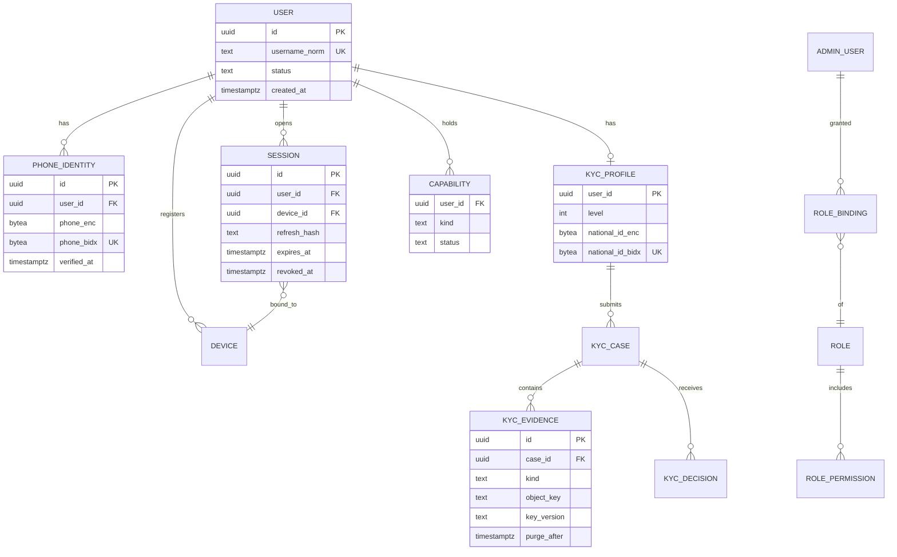
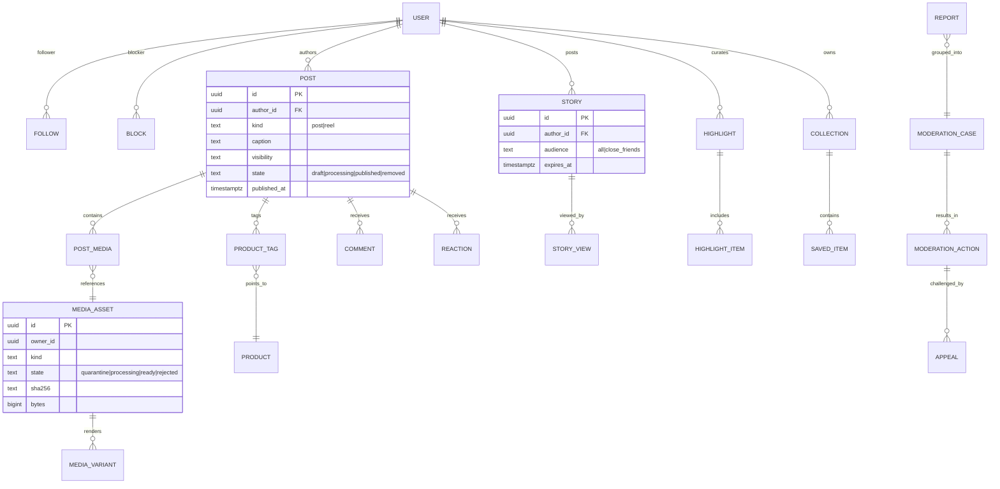
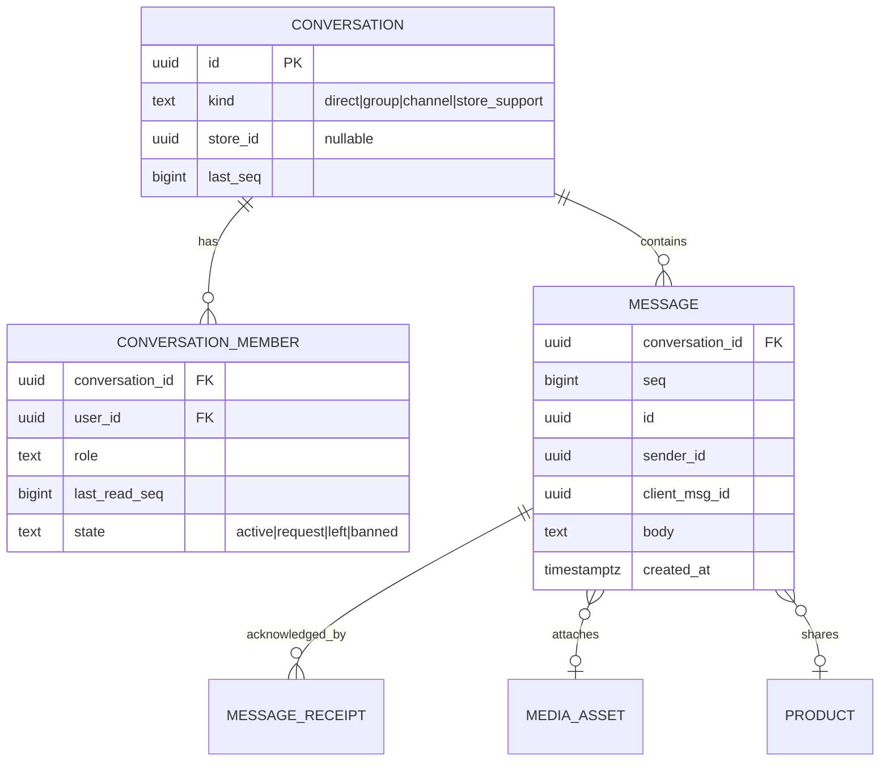
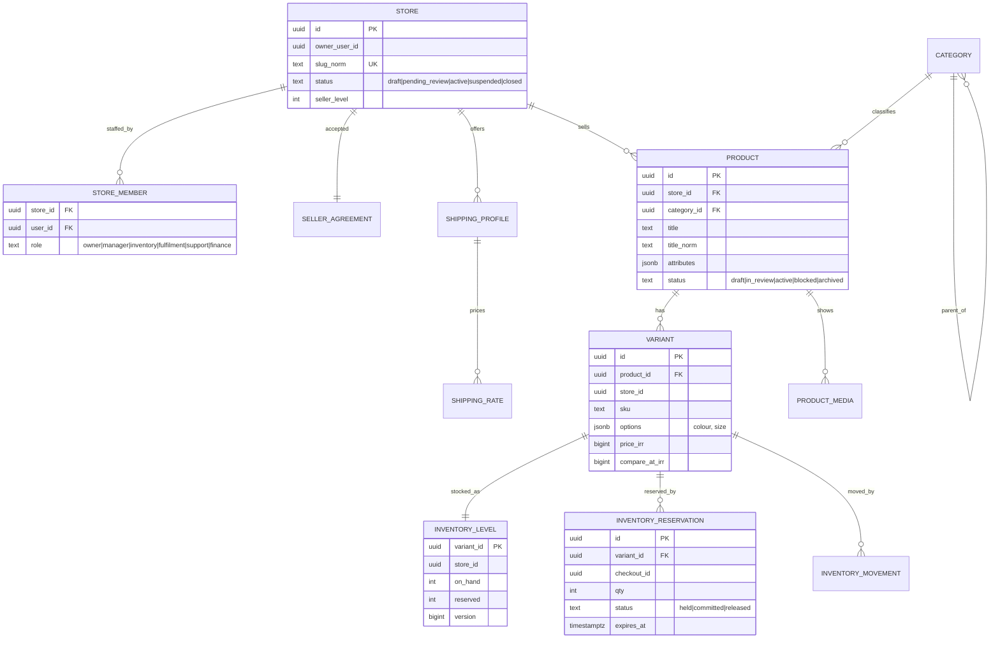
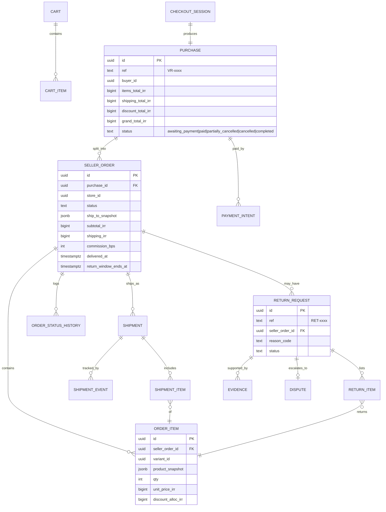
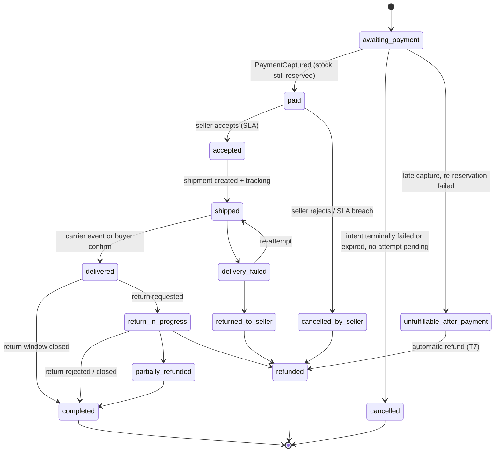
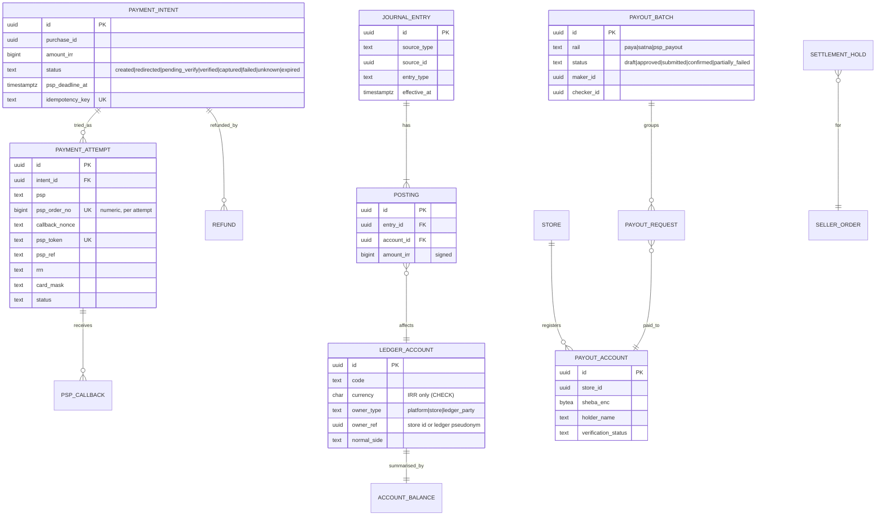

# 06 — Database Architecture and ERD

**Status:** Phase 0 v3 (final for owner acceptance; v2/v3 additions marked). Physical names are indicative; Phase 1 produces the first migration set from this design.

## 1. Principles

1. **PostgreSQL is the system of record** for everything except media bytes (object storage) and derived indexes (search, caches).
2. **Schema per module; DB role per runtime/access path** (amended after audit F-03). Roles: `app_public` (mobile + seller API), `app_admin` (`vira-admin-api`), `app_worker`, `app_ledger_writer` (granted INSERT-only on ledger tables, assumed via `SET LOCAL ROLE` only inside the registered transaction scripts), `migrator` (owner of all objects, never used at runtime). Schema boundaries between modules are enforced by architecture lint and a CI SQL-ownership check, not by grants — a single transaction must be able to span the schemas listed in §5. Runtime roles never own tables, so RLS cannot be bypassed by ownership. Connection pooling: PgBouncer in **transaction mode**; all session state is `SET LOCAL` inside an explicit transaction; connection budget per runtime is set in Phase 1.
3. **Money is integer Rial (`BIGINT`)**, never `NUMERIC` in application logic and never floating point. Currency column present (`'IRR'` only enabled).
4. **Append-only where history matters:** ledger postings, inventory movements, order status history, audit events, moderation actions, KYC decisions.
5. **Every externally-triggered write is idempotent** (unique business key or `idempotency_keys` row).
6. All timestamps `timestamptz` in UTC; Jalali conversion only at presentation.
7. Soft-delete only where legally required to retain (orders, ledger); user-content deletion is real deletion of content + tombstone row.
8. Persian text stored as entered **plus** a normalised column for search/uniqueness (usernames, store names, product titles).

## 2. Schemas

| Schema | Module | Classification | Notes |
|---|---|---|---|
| `identity` | identity | PII | phone numbers encrypted + blind index |
| `kyc` | kyc | **Highly sensitive** | evidence stored in `kyc-evidence` bucket; DB holds encrypted references and decisions |
| `authz` | authz | Security | admin + seller-staff role bindings |
| `social` | social-graph, content, engagement | User content | high write volume on reactions |
| `feed` | feed & discovery | Derived | can be rebuilt |
| `moderation` | moderation | Sensitive | |
| `media` | media | Metadata | |
| `messaging` | messaging | **Private communications** | hash-partitioned by conversation |
| `notify` | notifications | | partitioned; columns include `recipient_id`, `store_id` (nullable), `category` for seller notifications (doc 04 §10.5) |
| `live` | live & calls | | Phase 8 |
| `store` | stores & sellers | Business data | RLS by `store_id` |
| `catalog` | catalog & inventory | Business data | RLS by `store_id` |
| `checkout` | cart & checkout | | |
| `orders` | orders & fulfilment, returns, reviews | PII (addresses) | RLS by `store_id` on seller views |
| `payments` | payments | **Financial** | |
| `ledger` | ledger | **Financial — strict** | append-only, separate role, no `UPDATE/DELETE` grants |
| `settlement` | settlement & payouts | **Financial** | Sheba encrypted |
| `risk` | fraud & risk | Sensitive | |
| `support` | support | PII | |
| `platform` | config, flags, audit, outbox infrastructure | Security | `audit_events` append-only |

## 3. Seller data isolation

Seller-scoped tables carry `store_id NOT NULL`. Every seller request runs inside an **explicit transaction** (enforced by middleware and a lint rule) that executes `SET LOCAL app.audience = 'seller'` and `SET LOCAL app.store_id = '<uuid>'` after the authz check. Buyer/public requests set `app.audience = 'public'`. Policies are per command and audience (amended after audit F-04):

```sql
ALTER TABLE catalog.products ENABLE ROW LEVEL SECURITY;
ALTER TABLE catalog.products FORCE ROW LEVEL SECURITY;   -- owner (migrator) not used at runtime anyway

-- Buyers and anonymous browsing: only active products, read-only
CREATE POLICY public_read ON catalog.products FOR SELECT TO app_public
  USING (current_setting('app.audience', true) = 'public' AND status = 'active');

-- Sellers: full access to their own store's rows only
CREATE POLICY seller_rw ON catalog.products FOR ALL TO app_public
  USING      (current_setting('app.audience', true) = 'seller'
              AND store_id = NULLIF(current_setting('app.store_id', true), '')::uuid)
  WITH CHECK (store_id = NULLIF(current_setting('app.store_id', true), '')::uuid);
```

`NULLIF(…,'')` matters: after a `SET LOCAL` ends, a custom setting reverts to an empty string on a pooled connection, and `''::uuid` would raise. With no context set, both policies evaluate to false (fail closed, no error). `app_admin` has `BYPASSRLS` and every admin query is audited at the application layer; `app_worker` does **not** have `BYPASSRLS` — jobs that must cross stores (e.g. hold release) set `app.audience = 'system'` against narrowly scoped `system_*` policies on the specific tables they need. Integration tests assert that a seller token cannot read another store’s rows via any endpoint (doc 11 §3).

## 4. Entity-relationship diagrams

### 4.1 Identity, KYC, authorization



`CAPABILITY.kind ∈ {buyer, creator, seller}`. Admin users live in a separate table set (`authz.admin_users`) with no FK to platform users (ADR-016).

### 4.2 Social and media



Counters (likes, comments, followers) are kept in separate `*_counters` tables updated asynchronously and reconciled nightly, to avoid hot-row contention on popular posts.

### 4.3 Messaging



`MESSAGE` primary key `(conversation_id, seq)`; **hash-partitioned by `conversation_id`** (32 partitions — PostgreSQL requires the partition key inside the primary key, so time-range partitioning would break this key); retention is enforced by a batched purge job per D-12; unique `(conversation_id, sender_id, client_msg_id)` for idempotent sends (must include the partition key — audit F-13). `seq` allocated by `UPDATE conversation SET last_seq = last_seq + 1 RETURNING last_seq` inside the insert transaction.

### 4.4 Stores, catalog, inventory



Constraint: `CHECK (on_hand >= 0 AND reserved >= 0 AND reserved <= on_hand)`. Reservation is a single conditional update:

```sql
UPDATE catalog.inventory_levels
   SET reserved = reserved + $qty, version = version + 1
 WHERE variant_id = $v AND on_hand - reserved >= $qty;
-- 0 rows → out of stock, no oversell possible
```

Multi-variant reservations lock in ascending `variant_id` order to avoid deadlocks. A seller stock decrease below the reserved quantity is **rejected** with `409 stock_below_reserved` (showing the reserved count); the seller may instead mark the variant “stop selling”, which blocks new reservations while existing ones complete (audit F-26).

### 4.5 Checkout, orders, shipments, returns



`commission_bps` (basis points) snapshots the commission rate at order time; later fee-schedule changes never alter existing orders.

The delivery address snapshot lives on `SELLER_ORDER` (copied per seller at T1), so seller-scoped reads never touch `PURCHASE`, which holds cross-seller totals (audit F-04).

**Seller order state machine:**



### 4.6 Payments, ledger, settlement



## 5. Transaction scripts (the only allowed cross-schema transactions)

**Rules for every script (amended after audit F-02, F-14, F-26):** (1) any script that touches a payment intent first takes `SELECT … FOR UPDATE` on the intent row, whatever the isolation level, and every status change is a guarded `UPDATE … WHERE status IN (<allowed predecessors>)` — `captured` is terminal and cannot be overwritten; (2) rows are locked in a fixed order — intent → inventory levels sorted by `variant_id` → ledger balance rows sorted by account ID; (3) SERIALIZABLE scripts retry the whole closure (max 5, jittered back-off) and contain **no** external calls.

| # | Script | Schemas touched | Isolation |
|---|---|---|---|
| T1 | `PlaceOrder` | checkout, catalog (reserve, sorted), orders (purchase, seller_orders, items), payments (intent), outbox | READ COMMITTED + conditional updates |
| T2 | `CapturePayment` (after verify/settle recorded as `verified`) | payments (attempt, intent), ledger (journal), outbox | SERIALIZABLE |
| T3 | `ExpireCheckout` — **only** if the intent has no attempt in `redirected / pending_verify / verified / unknown` and `now > psp_deadline_at`; otherwise reschedule | checkout, catalog (release), payments (intent → expired), orders (→ cancelled), outbox | READ COMMITTED + intent row lock |
| T4 | `ApproveReturnRefund` (before hold release) | orders (return), payments (refund record), ledger | SERIALIZABLE |
| T5 | `ReleaseHold` — only if no open return, dispute or risk case on the seller order | settlement (hold), ledger | SERIALIZABLE |
| T6 | `CreatePayoutRequest` | settlement, ledger (available → in-transit) | SERIALIZABLE |
| T7 | `LateCapture` — capture on an `expired` intent: re-reserve per seller order; reserved ones → `paid`, others → `unfulfillable_after_payment` + automatic refund of their share | payments, catalog, orders, ledger | SERIALIZABLE |
| T8 | `CancelSellerOrderRefund` — seller rejects / SLA breach / returned to seller | orders, payments (refund), ledger | SERIALIZABLE |
| T9 | `PostReleaseRefund` — refund or dispute decided after hold release (draws on available balance, else creates seller receivable) | orders, payments, ledger | SERIALIZABLE |
| T10 | `PayoutRejectedOrReturned` — checker rejects, bank fails, or a confirmed transfer is returned later | settlement, ledger | SERIALIZABLE |

All other cross-module effects are asynchronous via outbox. Each script is the unit to convert into a saga if a module is extracted.

## 6. Ledger design

### 6.1 Chart of accounts (platform books)

| Code | Type | Owner | Purpose |
|---|---|---|---|
| `PSP_CLEARING:{psp}` | Asset | platform | Money captured by PSP, not yet in bank |
| `BANK:{account}` | Asset | platform | Platform settlement bank account |
| `SELLER_HELD:{store}` | Liability | store | Seller proceeds under settlement hold |
| `SELLER_AVAILABLE:{store}` | Liability | store | Withdrawable seller balance |
| `PAYOUT_IN_TRANSIT:{store}` | Liability | store | Submitted to bank, not yet confirmed |
| `SELLER_RECEIVABLE:{store}` | Asset | store | Seller owes the platform (refund after release exceeded available balance); netted against future proceeds before any payout |
| `BUYER_REFUND_PAYABLE:{party}` | Liability | ledger party | Refund approved, not yet executed. `party` is a **ledger pseudonym** mapped to the user in the identity schema; erasure deletes the mapping, financial retention keeps the pseudonym (audit F-29) |
| `PAYOUT_RETURNED` | Liability | platform | Funds of a transfer returned by the bank, pending match to the seller |
| `COMMISSION_REVENUE` | Revenue | platform | Marketplace commission |
| `TAX_PAYABLE:{tax}` | Liability | platform | Tax on commission (rate configurable, D-07) |
| `PSP_FEE_EXPENSE` | Expense | platform | Gateway fees |
| `PROMO_EXPENSE` | Expense | platform | Platform-funded discounts |
| `SUSPENSE` | Asset/Liability | platform | Unmatched items pending investigation (must trend to 0) |

### 6.2 Worked example (platform-collects model)

Buyer pays **1,000,000 IRR**: Store A items 600,000, Store B items 400,000. Commission 10%; tax on commission 10% (illustrative); PSP fee 0.5%.

| Event | Debit | Credit | Amount |
|---|---|---|---|
| Capture | `PSP_CLEARING` | `SELLER_HELD:A` | 600,000 |
| | `PSP_CLEARING` | `SELLER_HELD:B` | 400,000 |
| PSP settles to bank (T+1) | `BANK` 995,000; `PSP_FEE_EXPENSE` 5,000 | `PSP_CLEARING` | 1,000,000 |
| Partial return approved, B item 100,000 | `SELLER_HELD:B` | `BUYER_REFUND_PAYABLE:buyer` | 100,000 |
| Refund executed | `BUYER_REFUND_PAYABLE:buyer` | `BANK` | 100,000 |
| Hold release A | `SELLER_HELD:A` 600,000 | `SELLER_AVAILABLE:A` 534,000; `COMMISSION_REVENUE` 60,000; `TAX_PAYABLE` 6,000 | 600,000 |
| Hold release B | `SELLER_HELD:B` 300,000 | `SELLER_AVAILABLE:B` 267,000; `COMMISSION_REVENUE` 30,000; `TAX_PAYABLE` 3,000 | 300,000 |
| Payout A requested | `SELLER_AVAILABLE:A` | `PAYOUT_IN_TRANSIT:A` | 534,000 |
| Bank confirms payout A | `PAYOUT_IN_TRANSIT:A` | `BANK` | 534,000 |

Commission is recognised at hold release so returns before release need no commission reversal. Whether commission is charged on shipping, who bears PSP fees, and the tax base are **policy inputs (D-07)**; the posting rules are table-driven so these change without code changes.

### 6.2a Complete posting-rule set (platform-collects model; amended after audit F-05, F-06)

Notation per seller order *s*: `items_s`, `ship_s` (shipping, collected for the seller under A3), `disc_seller_s` (seller-funded discount), `disc_platform_s` (platform-funded discount). Buyer pays `grand = Σ(items_s + ship_s − disc_seller_s − disc_platform_s)`.

| # | Event | Debit | Credit |
|---|---|---|---|
| P1 | Capture | `PSP_CLEARING` = grand; `PROMO_EXPENSE` = Σ disc_platform_s | `SELLER_HELD:s` = items_s + ship_s − disc_seller_s (each s) |
| P2 | PSP settles | `BANK` (net); `PSP_FEE_EXPENSE` (fee) | `PSP_CLEARING` (gross) |
| P3 | Refund approved before release (T4, T8) | `SELLER_HELD:s` (refunded share) | `BUYER_REFUND_PAYABLE:party` |
| P4 | Refund executed via PSP refund/reversal **before** PSP settlement | `BUYER_REFUND_PAYABLE` | `PSP_CLEARING` |
| P5 | Refund executed via PSP refund **after** settlement, or by bank transfer | `BUYER_REFUND_PAYABLE` | `BANK` (or `PSP_CLEARING` if the PSP nets it from the next settlement — per PSP contract) |
| P6 | Hold release (T5) | `SELLER_HELD:s` | `SELLER_RECEIVABLE:s` (net off first, up to its balance); `SELLER_AVAILABLE:s` (rest); `COMMISSION_REVENUE`; `TAX_PAYABLE` |
| P7 | Refund after release (T9) | `SELLER_AVAILABLE:s` up to balance; remainder `SELLER_RECEIVABLE:s` | `BUYER_REFUND_PAYABLE`; reverse the commission share: Dr `COMMISSION_REVENUE`, `TAX_PAYABLE` / Cr `SELLER_AVAILABLE:s` per policy |
| P8 | Platform-funded goodwill refund | `PROMO_EXPENSE` (or `CUSTOMER_GOODWILL_EXPENSE`) | `BUYER_REFUND_PAYABLE` |
| P9 | Payout requested (T6) | `SELLER_AVAILABLE:s` | `PAYOUT_IN_TRANSIT:s` |
| P10 | Payout confirmed | `PAYOUT_IN_TRANSIT:s` | `BANK` |
| P11 | Payout rejected by checker / failed (T10) | `PAYOUT_IN_TRANSIT:s` | `SELLER_AVAILABLE:s` |
| P12 | Confirmed payout returned later (T10) | `BANK` | `PAYOUT_RETURNED`, then on match: Dr `PAYOUT_RETURNED` / Cr `SELLER_AVAILABLE:s` and the payout account is flagged for re-verification |
| P13 | Unmatched PSP/bank item | `SUSPENSE` or counter-account | as found — must be resolved by case |

**Rounding rule:** amounts are computed per seller order in integer Rial with half-even rounding; any residue from splitting a purchase-level amount (discount, fee) is assigned to the platform account of that line, so that for every purchase `Σ credits to sellers + platform lines = grand total` exactly. Tested for every generated purchase (doc 11 §2).

**Coupons are excluded from P6** until finance signs off rules P1/P8 with real D-07 inputs.

### 6.3 Alternative: PSP split settlement (تسهیم) — **open CRITICAL item (audit F-01)**

If D-05 selects PSP-side split (the PSP pays each seller’s Sheba directly), the platform **does not hold seller funds**: there is no `SELLER_HELD` balance to absorb refunds after settlement. Consequences: refunds after split need seller clawback or platform-funded refunds; settlement hold periods are not enforceable; the ledger records memo entries mirroring PSP settlements. This trade-off (regulatory simplicity vs. return/fraud protection) is the single most important financial decision in D-05.

**Status:** only the platform-collects model is specified in full (§6.2a). If counsel and the PSP indicate that platform collection requires a licence VIRA will not hold, a complete second rule set must be written **before P6 design freeze**: memo postings mirroring PSP split reports, a `SELLER_RECEIVABLE`-based clawback for refunds after split, the platform-funded refund path, reconciliation against PSP split files, and rewritten hold/D-06 rules and user-facing copy. P6 must not start on the platform-collects design until this question is answered in writing.

### 6.4 Invariants (enforced by DB and tested continuously)

1. `SUM(postings.amount) = 0` per `journal_entry` and per currency — deferred constraint trigger; accounts carry `currency` with `CHECK (currency = 'IRR')`.
2. Postings and entries are never updated or deleted (no grants; trigger raises).
3. `UNIQUE (source_type, source_id, entry_type)` on `journal_entries` — replaying a capture/refund/payout cannot double-post.
4. `SELLER_AVAILABLE` and `PAYOUT_IN_TRANSIT` balances may not go negative (checked in T6, T9, T10 with `SELECT … FOR UPDATE` on the balance rows, locked in account-ID order); shortfalls go to `SELLER_RECEIVABLE`, and **no payout is created while a store’s receivable is non-zero**.
5. Nightly job recomputes all balances from postings and compares to `account_balances`; any difference pages the on-call and freezes payouts.
6. Platform aggregate accounts (`PSP_CLEARING`, `COMMISSION_REVENUE`, `TAX_PAYABLE`, `PROMO_EXPENSE`) have no synchronous balance row (avoids hot rows during flash/live sales); their balances are computed from postings.

### 6.5 Financial architecture gate: platform collection vs PSP split settlement (v3)

The owner has **not** approved the platform-collects model (v3 brief §3). Before any real-money functionality, a formal decision is required, confirmed by **counsel and the selected PSP in writing**. Nothing in this section asserts what Iranian regulation requires.

| Dimension | **Model 1 — Platform collection** (VIRA receives buyer funds under an appropriate authorised arrangement) | **Model 2 — PSP split settlement (تسهیم)** (PSP settles each seller’s share to the seller’s registered account) |
|---|---|---|
| Who holds seller funds between payment and settlement | VIRA (as liability `SELLER_HELD` / `SELLER_AVAILABLE`) | The PSP / banking system; VIRA holds only its commission share |
| Authorisation needed (to be confirmed) | An arrangement that permits collecting on behalf of sellers (counsel to name it) | PSP split service contract; each seller registered with the PSP as beneficiary |
| Settlement hold & return window | Enforceable by VIRA (release after return window) | Only if the PSP supports delayed or conditional split; otherwise sellers are paid on the PSP cycle |
| Refund before settlement | From `SELLER_HELD` (posting P3) | PSP reversal/refund API if available |
| Refund after settlement | From `SELLER_AVAILABLE` or `SELLER_RECEIVABLE` (P7) | **Clawback from seller** (receivable + netting against future splits, if the PSP supports deductions) or platform-funded refund |
| Seller payouts | VIRA initiates (Paya/Satna/PSP payout), maker–checker (T6, T10) | Not needed for order proceeds (PSP pays); still needed for corrections/receivables |
| Ledger | Full books for seller balances (§6.1–6.2a) | Memo ledger mirroring PSP split reports; seller receivables; commission revenue; no seller cash balances |
| Reconciliation | PSP ↔ bank ↔ ledger ↔ payouts (R1–R5) | PSP split report ↔ ledger ↔ seller-level confirmations; payout recon reduced |
| Fraud / return exposure for buyers | Lower (funds held until return window) | Higher (seller already paid); needs seller deposits, risk limits or reserves |
| Seller experience | Balance + withdrawal screens (as designed in the UI) | “Settled by bank” statements; withdrawal screens largely unnecessary |
| Wallet / stored value (gated G1) | Adjacent to Model 1 infrastructure; still needs its own licence decision | Requires separate arrangement in any case |
| USDT tracks (gated G2) | Out of both models; separate custody/exchange arrangements | Same |
| UI copy (“escrow”, “held”) | “Held until return window” possible (legal wording per D-06) | Must not promise holding of funds |
| Components affected | settlement module, payout rails, holds, receivables | split-report ingestion, seller PSP registration, receivables, clawback |
| Common to both | Payment intents, verify/settle/inquiry, idempotency, refunds API, ledger core and invariants, reconciliation framework, audit | |

**Decision procedure:** (1) counsel opinion on permissible models for VIRA’s entity; (2) PSP shortlist confirms split capabilities (delayed split, deductions, refund after split, reports); (3) owner selects the model; (4) architect finalises the corresponding posting-rule set (Model 1 = §6.2a; Model 2 = new rule set) for finance sign-off; (5) P6 design freeze. Steps (1)–(4) form gate **FG-1a**, which must pass before the P6 design freeze; real-money activation is the later gate **FG-1b** (doc 12 §v3). **Phase 1 is not blocked by these gates** — the ledger core and payment-intent machinery are model-independent.

## 7. Reconciliation

| Recon | Sources | Frequency | Break handling |
|---|---|---|---|
| R1 Payments | `payment_attempts` captured vs PSP transaction report | Daily (T+1 morning) + intraday inquiry for `unknown` | Missing in PSP → mark failed and release; missing in VIRA → `SUSPENSE` + case |
| R2 Settlement | PSP settlement report vs `BANK` postings vs bank statement | Daily | Amount mismatch → case; payouts paused if > threshold |
| R3 Payouts | `payout_requests` vs bank/Paya response file | Per batch + daily | Failed → reverse to `SELLER_AVAILABLE` |
| R4 Ledger integrity | postings vs balances | Nightly | Freeze payouts, page |
| R5 Orders ↔ ledger | every captured purchase has matching journal; every completed seller order has a release | Nightly | Case |

Reconciliation results are stored (`ledger.recon_runs`, `ledger.recon_breaks`) and surfaced in the admin reconciliation screen (`vira_financial_reconciliation_settlements_dark`) — **without** the USDT section.

## 8. Cross-cutting tables

| Table | Purpose | Key design |
|---|---|---|
| `platform.idempotency_keys` | Dedup client retries for POSTs | `(principal_id, key)` PK; request hash; `state ∈ {in_progress, completed, failed_retryable}` with lease expiry. A second request while `in_progress` gets `409 request_in_progress` + `Retry-After`; `completed` replays the stored response; `failed_retryable` (timeouts, provider errors) re-executes — transient failures are **never** stored as the final answer (audit F-23). 24 h TTL (payments: 30 days) |
| `platform.outbox` | Event publication (single table, ADR-006) | `event_id uuid PK, module, aggregate_type, aggregate_id, aggregate_version, type, payload jsonb, created_at, dispatched_at`; **not partitioned** — dispatched rows are deleted after 7 days (batched) |
| `platform.inbox` | Consumer dedup | `(consumer, event_id)` PK; pruned after 30 days |
| `platform.audit_events` | Who did what | append-only; partitioned monthly with PK `(created_at, id)`; sealed hourly: a Merkle root of the hour’s rows is signed with a key held outside the database and written with the batch to WORM storage (audit F-27); admin list views logged as one event per query (filter + row IDs), not per row |
| `platform.feature_flags` | Flags & remote config | versioned; every change audited |

## 9. Partitioning, indexing, volume (planning figures)

| Table | Partition | Est. rows at 100k DAU / year | Notes |
|---|---|---|---|
| `messaging.messages` | hash by `conversation_id` (32) | ≈ 0.4 B (1 M/day, doc 10 Tier B) | move to dedicated cluster beyond ~2 B |
| `social.reactions` | hash by `post_id` (16) | 300–600 M | |
| `notify.notifications` | monthly, PK `(created_at, id)`, 90-day retention by dropping partitions | 200 M rolling | |
| `feed.feed_items` | none (rebuildable, TTL 14 days) | — | could move to Redis |
| `platform.audit_events` | monthly, PK `(created_at, id)` | 50–100 M | retain per D-12 |
| `ledger.postings` | **none** (10–30 M rows/year needs no partitioning) | 10–30 M | never purged |

## 10. Migrations

* Forward-only migrations (golang-migrate / Atlas-class), reviewed like code.
* **Expand → migrate → contract** for any breaking change; old app versions must keep working through the minimum-supported-version window.
* No migration may take an `ACCESS EXCLUSIVE` lock on a large table during business hours; use `CREATE INDEX CONCURRENTLY`, batched backfills.
* Ledger schema changes require finance sign-off.

## 11. Backup and disaster recovery (data layer)

| Asset | Method | RPO | RTO | Retention |
|---|---|---|---|---|
| PostgreSQL (all) | Patroni-class HA manager; **quorum synchronous replication** `ANY 1 (standby_a, standby_b)` across two failure domains so one standby failure does not block commits; fencing on failover; continuous WAL archive (`archive_timeout = 60 s`) + daily full; **off-provider encrypted copy** (a second in-country provider, to respect residency) of WAL + weekly full for provider-level loss (audit F-18) | ≈ 0 for committed transactions; ≤ 1 min from archive | ≤ 1 h (promote standby); ≤ 4 h from in-provider backup; ≤ 24 h from off-provider copy (provider-loss scenario) | 35 days PITR; monthly fulls 1 year; ledger exports per D-12 |
| Object storage (media) | Provider replication or nightly cross-site sync | ≤ 24 h | ≤ 24 h | Mirror deletes after 30 days |
| KYC evidence | Cross-site replication, encrypted | ≤ 1 h | ≤ 24 h | Purged per D-10 |
| Redis | None needed (cache) | n/a | minutes | — |
| NATS (core; JetStream when adopted) | No durable state at Tier A; outbox is the source | 0 (outbox replays) | minutes | — |

Restore drills: monthly automated restore to an isolated environment with ledger integrity check (R4) run against the restored copy.
