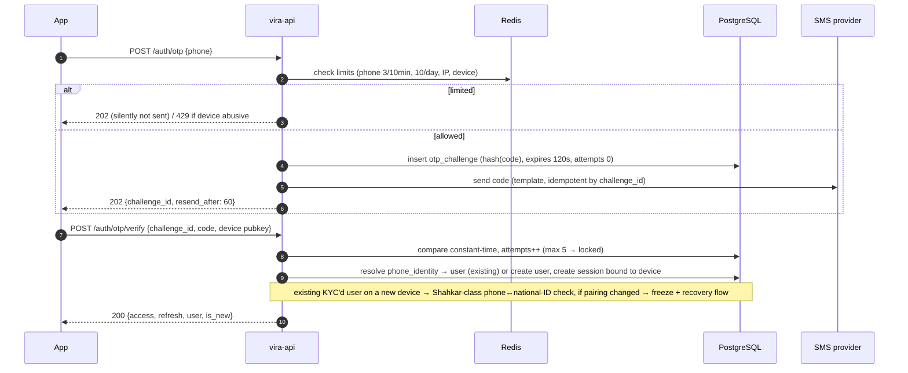
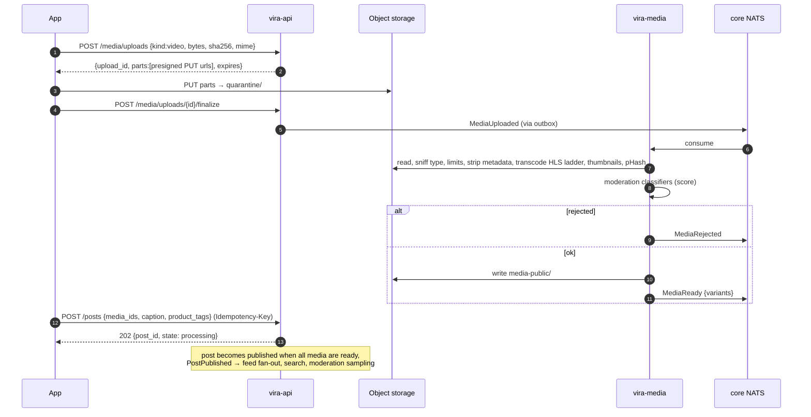
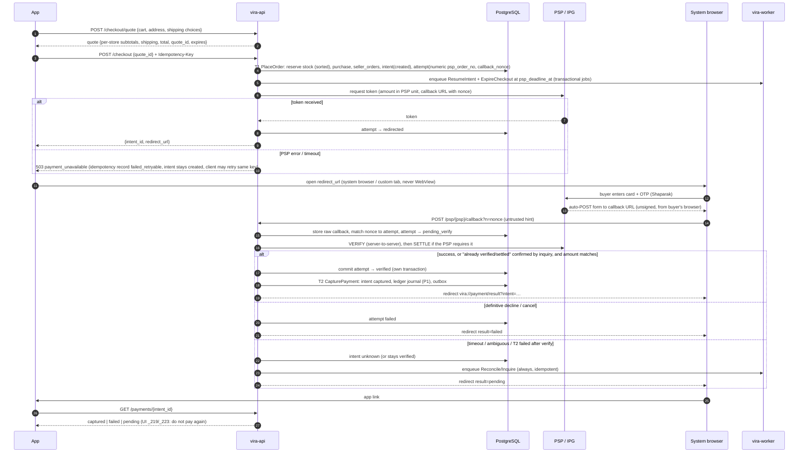
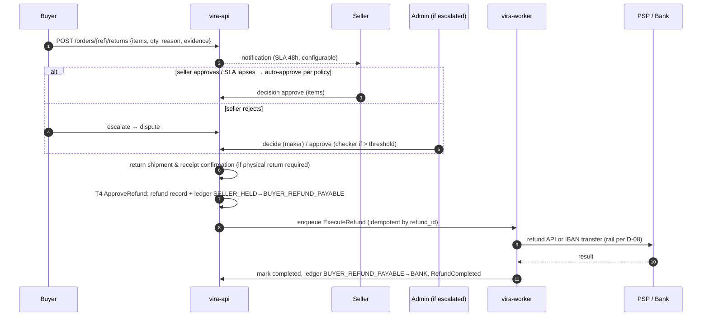
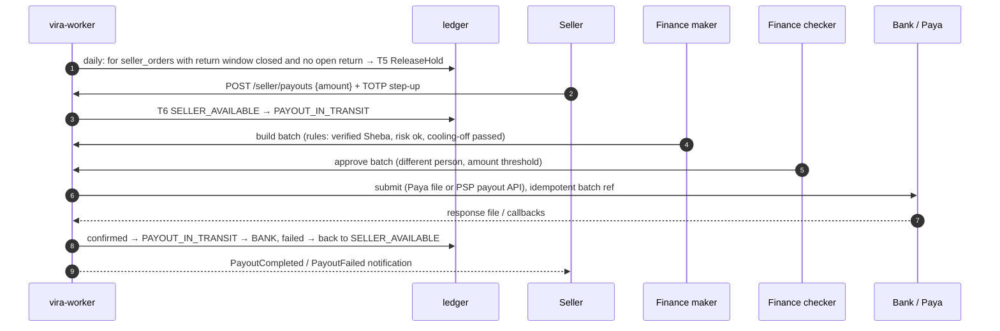
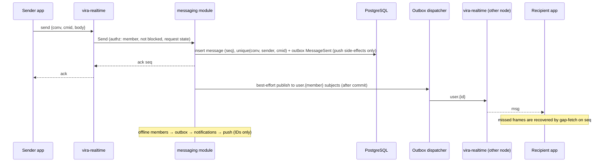

# 07 — API and Event Contracts

**Status:** Phase 0 v3 (final for owner acceptance; v2/v3 additions marked). The OpenAPI 3.1 and AsyncAPI files are Phase 1 deliverables generated from this specification; this document fixes conventions, critical contracts and failure semantics.

## 1. Conventions

| Topic | Rule |
|---|---|
| Base URLs | `https://api.<domain>/v1` (mobile + seller web), `https://admin-api.<internal>/v1` (Super Admin, VPN only), `wss://rt.<domain>/v1` (realtime) |
| Versioning | URI major version; additive changes only within a version; deprecations announced via `Sunset` header ≥ 90 days; mobile minimum-version gate via remote config |
| Auth | `Authorization: Bearer <access JWT>` (10 min, ES256, `kid` rotation). Refresh token: opaque, rotating, single-use, bound to device public key (proof-of-possession signature header on refresh) |
| Seller context | `X-Store-Id` header on seller endpoints; server verifies membership and sets RLS context |
| Idempotency | `Idempotency-Key: <uuid>` **required** on every POST that creates orders, payments, refunds, payouts, messages, posts; optional elsewhere. Same key + different body → `409 idempotency_conflict` |
| Concurrency | `ETag` / `If-Match` on admin & seller edits of products, prices, stock, config; mismatch → `412` |
| Pagination | Cursor-based: `?cursor=&limit=` (max 50); response `{data:[…], next_cursor}` |
| Money | `{"amount": 12500000, "currency": "IRR"}` — integers only; clients format as Toman |
| Time | RFC 3339 UTC strings |
| Locale | `Accept-Language: fa-IR`; server returns user-facing messages in Persian, plus a stable `code` |
| Errors | RFC 9457 problem+json: `type, title, status, code, detail, trace_id, errors[]` |
| Rate limits | `429` with `Retry-After`; headers `RateLimit-Limit/Remaining/Reset` |
| Tracing | `traceparent` (W3C) accepted and returned |

### 1.1 Error codes (initial set)

`validation_failed`, `unauthenticated`, `forbidden`, `not_found`, `conflict`, `idempotency_conflict`, `precondition_failed`, `rate_limited`, `otp_invalid`, `otp_expired`, `otp_locked`, `kyc_level_required` (with `required_level`), `limit_exceeded`, `out_of_stock` (with `variant_ids`), `price_changed` (with new quote), `checkout_expired`, `payment_pending` (do not retry payment), `payment_failed`, `payout_blocked`, `feature_disabled`, `account_restricted`, `blocked_by_user`, `maintenance`, `upgrade_required`.

## 2. Endpoint catalogue (MVP surface)

| Module | Method & path | Notes |
|---|---|---|
| Auth | `POST /auth/otp` | body `{phone, purpose}`; always 202 (no user enumeration) |
| | `POST /auth/otp/verify` | `{challenge_id, code, device:{id, pubkey, platform}}` → tokens |
| | `POST /auth/token/refresh` | PoP-signed |
| | `GET /me/sessions`, `DELETE /me/sessions/{id}`, `POST /me/sessions/revoke-others` | |
| | `POST /me/2fa/totp`, `POST /me/2fa/totp/verify` | |
| | `POST /me/deletion` | starts grace period; blocked if open orders/balances |
| KYC | `GET /me/kyc`, `POST /kyc/cases`, `POST /kyc/cases/{id}/evidence-uploads`, `POST /kyc/cases/{id}/submit` | evidence via size-bound pre-signed upload to private `kyc-quarantine` → scan/re-render → `kyc-evidence` (never direct; audit F-19) |
| Social | `GET /users/{handle}`, `POST /users/{id}/follow`, `DELETE …/follow`, `POST /users/{id}/block` | |
| | `GET /feed/home`, `GET /explore`, `GET /reels/feed` | cursor |
| | `POST /posts`, `GET /posts/{id}`, `DELETE /posts/{id}` | `media_ids`, `product_tags[]` |
| | `POST /stories`, `GET /stories/tray`, `POST /stories/{id}/views` | |
| | `POST /posts/{id}/comments`, `POST /posts/{id}/like`, `POST /saves` | |
| | `POST /reports`, `POST /appeals` | |
| Media | `POST /media/uploads`, `POST /media/uploads/{id}/finalize`, `GET /media/{id}` | see §4.2 |
| Messaging | `GET /conversations`, `POST /conversations`, `GET /conversations/{id}/messages?before_seq=`, `POST /conversations/{id}/messages`, `POST /conversations/{id}/read` | send also via WS |
| Notifications | `GET /notifications`, `PUT /me/notification-preferences`, `POST /me/push-tokens` | |
| Stores | `POST /stores`, `GET /stores/{slug}`, `PATCH /stores/{id}`, `POST /stores/{id}/members` | seller |
| Catalog | `GET /products/{id}`, `GET /categories`, `GET /search?q=` | |
| | `POST /seller/products`, `PATCH /seller/products/{id}`, `PUT /seller/variants/{id}/inventory` | `X-Store-Id`, `If-Match` |
| Cart | `GET /cart`, `PUT /cart/items/{variant_id}`, `DELETE …` | |
| Checkout | `POST /checkout/quote`, `POST /checkout` | see §4.3 |
| Payments | `GET /payments/{intent_id}`, `POST /payments/{intent_id}/inquire` | `POST /psp/{psp}/callback` (PSP-facing, not app-facing) |
| Orders | `GET /orders`, `GET /orders/{ref}`, `POST /orders/{ref}/confirm-delivery` | buyer |
| | `GET /seller/orders`, `POST /seller/orders/{id}/accept`, `POST …/reject`, `POST …/shipments` | seller |
| Returns | `POST /orders/{ref}/returns`, `GET /returns/{ref}`, `POST /seller/returns/{id}/decision` | |
| Reviews | `POST /orders/{ref}/items/{id}/review` | verified purchase only |
| Payouts | `GET /seller/balance`, `POST /seller/payout-accounts`, `POST /seller/payouts` | 2FA step-up |
| Support | `POST /tickets`, `GET /tickets/{ref}`, `POST /tickets/{ref}/messages` | |
| Config | `GET /config/bootstrap` | flags, min version, maintenance |

Admin API mirrors the Super Admin screens with `/admin/...` routes; every mutating admin route requires `reason` and, where configured, a second approver (`/admin/approvals/{id}/approve`).

## 3. Realtime (WebSocket) protocol

```text
client → server  {"op":"hello","token":"<access>","resume":"<cursor?>"}
server → client  {"op":"ready","session":"…","heartbeat_ms":25000}
client → server  {"op":"send","conv":"<id>","cmid":"<uuid>","body":"…"}
server → client  {"op":"ack","cmid":"…","seq":1043}
server → client  {"op":"msg","conv":"…","seq":1043,"from":"…","body":"…","ts":"…"}
server → client  {"op":"notif","id":"…","kind":"order_shipped","ref":"VR-…"}
server → client  {"op":"presence","user":"…","state":"online"}
client → server  {"op":"typing","conv":"…"}
both              {"op":"ping"} / {"op":"pong"}
```

Delivery is **at-least-once**; clients dedupe by `(conv, seq)`. On reconnect the client fetches gaps via `GET /conversations/{id}/messages?after_seq=`. Presence is best-effort and privacy-controlled.

## 4. Critical workflows

### 4.1 OTP authentication



Codes are 6 digits, stored hashed with a per-challenge salt, single use. SMS delivery failures fall back to a second provider (voice OTP optional). SIM-swap risk: new device + recent number change → step-up or cooling-off for payouts (doc 08 §2 T02, §3).

**Recycled numbers and account recovery (amended after audit F-09).** Mobile numbers are reassigned by operators, so “holds the SIM” is not “owns the account”:

* For users at KYC ≥ L1, the phone ↔ national-ID pairing is re-checked through a Shahkar-class ownership service (provider to be contracted — dependency register, doc 13 §4) at login from a new device and periodically. A changed pairing freezes the account (read-only, no DMs, no payouts) and routes to recovery.
* For users below L1, signals of a dormant/recycled number (no login for > N months, new device, different carrier metadata where available) put the session in a restricted state that hides DMs, addresses and order history until the user re-verifies (e.g. confirms a previous device, an email if collected, or completes L1).
* **Recovery flow:** national-ID entry + Shahkar-class match for the *new* number + liveness against the stored KYC reference → admin review for seller accounts → phone_identity replaced, all sessions revoked, 72 h payout cooling-off.
* **Number change by the user:** OTP to both old (if reachable) and new numbers, or recovery flow if the old number is lost.

### 4.2 Media upload and publishing



### 4.3 Checkout and payment (Iranian IPG redirect model) — amended after audit F-02, F-07, F-23

PSP protocols differ (request-token → redirect → browser-mediated callback → verify, and for some PSPs a separate **settle** step; distinct “already verified/settled” codes; amounts in Rial or Toman). Each PSP gets an **adapter state machine** recorded in its own ADR from the signed contract and sandbox; the flow below is the common shape.



**Rules**

1. The app never decides payment success; the callback is only a hint. Only a server-to-server verify (and settle, where required) or inquiry result counts. There is **no PSP IP allowlist on the callback** — it arrives from the buyer’s browser.
2. Callbacks are matched to the attempt by a server-generated nonce in the callback URL and the PSP token; duplicates are accepted and ignored once the attempt is terminal. An “already verified/settled” response is mapped to success **only after** an inquiry confirms amount and reference.
3. The verify outcome is persisted (`attempt = verified`) in its own committed step **before** T2. If T2 then fails, a reconcile job completes the capture; money is never verified without a durable record.
4. Each intent has `psp_deadline_at` = PSP session lifetime + verify window (from the PSP contract; configurable). Stock stays reserved and orders stay `awaiting_payment` until the intent is terminal **or** that deadline passes with no attempt in `redirected / pending_verify / verified / unknown`. `ExpireCheckout` checks this under the intent row lock and reschedules itself otherwise (doc 06 T3).
5. Inquiry schedule for `unknown`: +1, +2, +5, +10, +30 min, then hourly to the PSP’s reconciliation cut-off; anything still unknown goes to a finance queue and is closed by daily reconciliation R1.
6. A capture that arrives for an `expired` intent runs T7 `LateCapture`: re-reserve per seller order; reserved parts proceed, unreservable parts become `unfulfillable_after_payment` and are refunded automatically with a notification.
7. While **any** intent of the buyer is `redirected / pending_verify / verified / unknown`, `POST /checkout` returns `payment_pending` regardless of cart edits (keyed on buyer, not cart).
8. Amounts: the adapter converts IRR to the PSP’s unit explicitly; the PSP-reported amount must equal the intent amount exactly, otherwise do not verify/settle (let it reverse), and open a risk case.
9. `psp_order_no` is a numeric, per-attempt, never-reused sequence, because many Iranian PSPs require numeric unique order IDs.

### 4.4 Refund (partial return)



### 4.5 Settlement and payout



### 4.6 Messaging send



### 4.7 Live shopping (Phase 8)

Host app → `POST /live/sessions` → ingest credentials (WHIP/RTMP, short-lived) → media server transcodes → LL-HLS via CDN; viewers `GET /live/sessions/{id}` → playback URL (signed) + realtime channel `live.{id}` for chat, product pins and stock counters. Purchases use the normal checkout (§4.3) with `source=live:{id}` attribution. Admin “emergency stop” revokes ingest credentials and playback tokens within 5 s and is audited.

## 5. Event contracts

### 5.1 Envelope (CloudEvents 1.0 compatible)

```json
{
  "specversion": "1.0",
  "id": "0192f1c6-7b7a-7c1e-9d2f-5a1b3c4d5e6f",
  "source": "vira/orders",
  "type": "vira.orders.order_delivered.v1",
  "subject": "seller_order/0192f1c6-…",
  "time": "2026-10-28T10:15:00Z",
  "datacontenttype": "application/json",
  "traceparent": "00-…",
  "aggregateid": "0192f1c6-…",
  "aggregateversion": 7,
  "data": { }
}
```

Subjects: `vira.<module>.<event>.v<N>`. Schemas (JSON Schema) live in a contracts repo; breaking changes create `v<N+1>` and both are published during migration.

### 5.2 Catalogue (MVP)

| Event | Producer | Key data | Consumers |
|---|---|---|---|
| `identity.user_registered.v1` | identity | user_id, created_at | kyc, notifications, risk |
| `identity.session_revoked.v1` | identity | user_id, session_id | realtime (disconnect) |
| `identity.account_deletion_scheduled.v1` | identity | user_id, effective_at | all PII-holding modules |
| `kyc.level_changed.v1` | kyc | user_id, old, new | stores, payments limits, notifications |
| `media.ready.v1` / `media.rejected.v1` | media | asset_id, variants / reason | content, catalog, messaging |
| `content.post_published.v1` | content | post_id, author_id, product_ids | feed, search, moderation |
| `content.post_removed.v1` | content/moderation | post_id, reason | feed, engagement, search |
| `moderation.content_actioned.v1` | moderation | target, action, policy_ref | content, notifications |
| `catalog.product_published.v1` | catalog | product_id, store_id | search, feed |
| `catalog.stock_low.v1` | catalog | variant_id, on_hand | notifications (seller) |
| `checkout.expired.v1` | checkout | checkout_id | catalog (release), payments |
| `orders.order_placed.v1` | orders | purchase_id, seller_order_ids | notifications, risk |
| `payments.payment_captured.v1` | payments | intent_id, purchase_id, amount | orders, notifications, risk |
| `payments.payment_failed.v1` | payments | intent_id, reason | checkout, orders |
| `orders.order_shipped.v1` | orders | seller_order_id, tracking | notifications |
| `orders.order_delivered.v1` | orders | seller_order_id, delivered_at | settlement, reviews, notifications |
| `returns.return_approved.v1` | returns | return_id, items, amount | payments, settlement |
| `payments.refund_completed.v1` | payments | refund_id, amount | orders, notifications |
| `settlement.hold_released.v1` | settlement | seller_order_id, amount | notifications |
| `settlement.payout_completed.v1` / `payout_failed.v1` | settlement | payout_id | notifications, risk |
| `messaging.message_sent.v1` | messaging | conv_id, seq, sender | realtime, notifications |
| `risk.flagged.v1` | risk | subject, score, rules | payments, settlement, admin |
| `config.flag_changed.v1` | config | key, old, new, actor | all runtimes (cache bust) |
| `media.uploaded.v1` | media | asset_id, kind | media workers |
| `social.followed.v1` / `social.blocked.v1` | social-graph | actor, target | feed, messaging, notifications |
| `moderation.user_restricted.v1` | moderation | user_id, scope, until | content, messaging, stores |
| `checkout.started.v1` | checkout | checkout_id, buyer_id | risk |
| `orders.order_cancelled.v1` | orders | seller_order_id, reason | catalog (release), payments (refund), notifications |
| `orders.return_window_closed.v1` | orders | seller_order_id | settlement |
| `returns.dispute_resolved.v1` | returns | dispute_id, outcome, amount | payments, settlement |
| `reviews.review_submitted.v1` | reviews | review_id, product_id | search, catalog rating |
| `stores.store_activated.v1` / `store_suspended.v1` | stores | store_id | catalog, search, settlement (suspension blocks payouts) |
| `ledger.journal_posted.v1` | ledger | entry_id, entry_type | finance reporting |
| `realtime.presence_changed.v1` | realtime | user_id, state | (ephemeral, core NATS only) |

The event catalogue is generated from one source (contracts repo) and CI checks it against the module “Emits/Consumes” table in doc 04 §2.1 (audit F-15). Ordering: per-aggregate order is guaranteed by dispatching each aggregate on one partition; consumers compare `aggregateversion` and park out-of-order events.

Events carry **IDs and minimal state**, not PII; consumers fetch details through module interfaces. This keeps the bus out of scope for most erasure requests.

## 6. Background jobs

| Job | Trigger | Idempotency key | Retry policy |
|---|---|---|---|
| ExpireCheckout | at `psp_deadline_at`; reschedules itself while any attempt is non-terminal | checkout_id | 5 attempts, 30 s back-off |
| ResumeIntent / InquirePayment | no callback +3 min; `unknown`; `verified` without capture | intent_id + attempt_no | +1, +2, +5, +10, +30 min, then hourly to PSP cut-off; then finance queue |
| ExecuteRefund | refund approved | refund_id | exponential to 24 h; then finance queue |
| ReleaseHolds | daily 02:00 | seller_order_id | safe re-run |
| BuildPayoutBatch | daily cut-off (Paya cycles) | batch date + rail | manual |
| ReconcilePSP | daily after PSP report | psp + date | safe re-run |
| LedgerIntegrity | nightly | date | page on failure |
| AutoConfirmDelivery | delivered_at + N days | seller_order_id | safe |
| PurgeExpiredStories | hourly | story_id | safe |
| PurgeKycEvidence | daily | evidence_id | safe |
| AccountDeletion | effective_at | user_id + module | per-module step state |
| CounterReconcile | nightly | object_id | safe |
| OutboxDispatch | continuous | event_id (consumer inbox dedupe) | infinite with back-off; alert at lag > 60 s |

## 7. Retry and failure policy

* **Clients** retry only idempotent requests (`GET`, or POST with `Idempotency-Key`) with exponential back-off + jitter (max 3). Never retry a payment redirect.
* **Outbound to providers:** circuit breaker per provider; timeouts 3 s (SMS), 10 s (PSP verify), 30 s (KYC); fall-back provider where contracted (SMS).
* **Consumers:** at-least-once; inbox dedupe; poison messages to a dead-letter stream after 10 attempts with alert; DLQ is replayable by tooling, not by hand-editing.
* **Provider outage playbook:** PSP down → checkout shows maintenance for payment step, carts preserved; SMS down → secondary provider; KYC down → queue submissions; object storage degraded → uploads paused, reads from CDN cache.

## 8. Seller surfaces (v3)

* `GET /me/stores` — stores the caller belongs to, with role and permissions (drives “Manage My Stall” visibility and the web store switcher).
* `POST /seller/applications` — start seller onboarding from an existing account (KYC/agreement steps reuse §2 endpoints).
* All `seller/*` endpoints require `X-Store-Id`; responses include `ETag`; writes require `If-Match` where the resource is editable concurrently.
* `GET /seller/notifications` and `POST /seller/notifications/read` (store from `X-Store-Id`) — shared inbox for mobile and web, filtered by the caller’s role.
* Realtime: `{"op":"subscribe","topic":"store.<id>.<scope>"}` with scope ∈ `orders | catalog | chat | finance`, authorised per role permission (doc 04 §10.4).
* Seller Admin web authentication: same OTP challenge as mobile; on success the web receives an httpOnly, `Secure`, `SameSite=Strict` session cookie bound to the browser plus a CSRF token; TOTP step-up for owner/finance actions.
