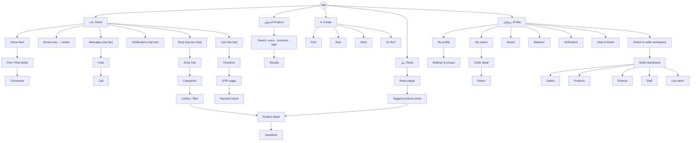

# 09 — Design System and Navigation Architecture

**Status:** Phase 0 v3 (final for owner acceptance; v2/v3 additions marked) · **v2 (2026-10-28):** §1.0, §4 and §5 updated from the original archive (doc 15). Evidence: the four distinct `DESIGN.md` versions (names, primary colours and font families as recorded in the manifest) and font/asset usage across 383 HTML files. v1 relied on the manifest; v2 inspected the archive directly (§1.0). Full extraction of the DESIGN.md token tables into the token pipeline is a Phase 1 design-system task.

## 1. Design-source reconciliation

| # | DESIGN.md | Copies | Primary | Fonts | Assessment |
|---|---|---|---|---|---|
| D1 | VIRA Super Admin (`vira_super_admin_1`) | 2 (identical) | `#8e0028` | Vazirmatn | Light-scheme crimson |
| D2 | VIRA Super Admin (`vira_super_admin_2`) | 2 (identical) | `#ffb1c5` | Vazirmatn | Dark-scheme counterpart (pink tone) |
| D3 | Vira Social Commerce (`vira_social_commerce_1`) | 1 | `#ffb2ba` | Noto Sans, Plus Jakarta Sans | Dark-scheme counterpart; **Latin fonts** |
| D4 | Vira Social Commerce (`vira_social_commerce_2`) | 1 | `#ba0038` | Bricolage Grotesque, DM Sans | Light-scheme crimson; **Latin fonts** |

**Reading:** the four files are two brand seeds (mobile crimson `#ba0038`, admin crimson `#8e0028`), each with a generated light/dark pair — consistent with Material 3 tonal palettes. They are not four contradictory brands, but they **do** disagree on seed and typography.

### 1.0 Measured evidence from the archive (v2)

| Signal | Mobile (277) | Super Admin (53) |
|---|---|---|
| Rendered theme (screenshot luminance) | 158 dark · 116 light · 2 mixed · 1 none | 48 dark · 5 light |
| `<html class="dark">` declared | 82 | 48 |
| Primary colour tokens declared | `#ffb2ba` (76), `#ba0038` (46), `#ff2d65` (1), none (154) | `#8e0028` (25), `#ff1753` (10), `#ba0038` (1), none (17) |
| Background token | `#0f131c` dark (76), `#faf9ff` light (46) | `#faf9ff` light (23) but rendered dark; `#0b0f17` (12) |
| Vazirmatn | never referenced on **162**; primary family on 30–82 depending on the measure | loaded on all 53 |
| Fonts shipped in archive | Vazirmatn v33.003 (148 WOFF2) — confirms ADR-014 | |
| Icons | Material Symbols (CDN) everywhere | same |
| Accessibility hints | `aria-label` present on 269 / 383 files; `role="dialog"` on 4; no `prefers-reduced-motion` | |

Conclusions: (1) the declared tokens do **not** predict the rendered theme — themes are applied ad hoc through utility classes; (2) at least **five** brand primaries are in use, so DS-01 (one seed) is necessary, not cosmetic; (3) there are no systematic light/dark pairs, so dark mode must be generated (DS-02).

### 1.1 Measured contrast (WCAG 2.x)

| Foreground on background | Ratio | Verdict |
|---|---:|---|
| `#ba0038` on `#FFFFFF` | 6.68 : 1 | ✅ AA text, AA large |
| `#FFFFFF` on `#ba0038` (button label) | 6.68 : 1 | ✅ |
| `#8e0028` on `#FFFFFF` | 9.63 : 1 | ✅ AAA |
| `#ffb2ba` on `#121212` | 11.0 : 1 | ✅ |
| `#ffb1c5` on `#121212` | 11.0 : 1 | ✅ |
| `#ba0038` on `#121212` | 2.81 : 1 | ❌ — light primary must **never** be reused in dark mode |

### 1.2 Decisions proposed

| ID | Decision |
|---|---|
| DS-01 | **One brand seed** for all surfaces (v2: five primaries found in use — `#ba0038`, `#ffb2ba`, `#8e0028`, `#ff1753`, `#ff2d65`). Recommend `#ba0038` (consumer brand is the public face); admin uses the same seed with a neutral-heavy, denser component variant. Owner/brand to confirm. |
| DS-02 | Generate light and dark schemes from the seed (M3 tonal algorithm) and **commit the generated tokens**; do not hand-pick per screen. |
| DS-03 | **Vazirmatn** is the single UI family (Persian + Latin + digits) for app and web (ADR-014). Bundled; variable font where supported. |
| DS-04 | Persian digits (۰–۹) in UI text by default; ASCII digits inside LTR-isolated technical strings (IBAN, card mask, tracking codes) — owner to confirm. |
| DS-05 | Remove runtime dependencies: Google Fonts, Material Symbols CDN, Tailwind Play CDN, `lh3.googleusercontent.com` images. |
| DS-06 | Icons: Material Symbols (Apache-2.0) self-hosted subset; maintain a **mirror list** for RTL (back/forward arrows, send, reply, undo/redo, progress chevrons, list bullets) and a **do-not-mirror** list (media play, clock, checkmarks, brand logos, phone). |

## 2. Token architecture

```text
reference tokens   →  system tokens            →  component tokens
color.crimson.40      color.primary               button.primary.bg
color.neutral.10      color.surface               card.bg
font.vazirmatn        type.body.md (14/22, 400)   product-card.price.type
space.4 = 16          space.inset.md              list.item.padding
radius.3 = 12         shape.corner.md             sheet.corner.top
motion.short.2        motion.enter                story-ring.rotate
```

* Source of truth: a tokens JSON (W3C Design Tokens format) in the design-system repo.
* Generated outputs: Dart `ThemeExtension` classes for Flutter; CSS custom properties for web; Figma variables (if Figma is adopted).
* Semantic colour set must include commerce semantics: `price`, `price.discount`, `badge.verified`, `status.success/warning/danger/info`, `live`, `sponsored` (ads must be visibly labelled).

### 2.1 Typography scale (Vazirmatn; Persian needs ~10–15% more line-height than Latin)

| Token | Size / line | Weight | Use |
|---|---|---|---|
| `display.sm` | 28 / 40 | 800 | Hero numbers (balances) |
| `title.lg` | 22 / 32 | 700 | Screen titles |
| `title.md` | 18 / 28 | 700 | Section headers |
| `body.lg` | 16 / 26 | 400 | Captions, descriptions |
| `body.md` | 14 / 24 | 400 | Default |
| `label.md` | 13 / 20 | 600 | Buttons, chips |
| `caption` | 12 / 18 | 400 | Meta, timestamps |
| `price.lg` | 20 / 28 | 800, tabular figures | Product price |

## 3. RTL & Persian localisation rules

| Topic | Rule |
|---|---|
| Direction | App root `TextDirection.rtl`; layout uses start/end, never left/right |
| Mixed text | Wrap Latin/number fragments with Unicode isolates (FSI…PDI) — product names like “Sony Alpha 7 IV”, order refs, usernames |
| Numbers | Persian digits; thousands separator `٬` (U+066C) or `,` — choose one (DS-07); negative values with isolate |
| Currency | Display “تومان” after amount; internal Rial ÷ 10; never round silently — prices must be whole Toman or the policy must define rounding |
| Dates | Jalali (Solar Hijri) for display, Gregorian UTC in data; relative times (“۳ دقیقه پیش”) |
| Phone | Accept Persian/Arabic/ASCII digits, with/without `+98`/`0`; display `۰۹۱۲ ۳۴۵ ۶۷۸۹` |
| ZWNJ | Preserve U+200C in input; keyboard-friendly; normalise for search only |
| Arabic vs Persian letters | Normalise ي→ی, ك→ک for search and unique keys; display as typed |
| Gestures | Horizontal carousels start at the right; “next” is leftward; story tap zones mirrored |
| Charts | Time axes right-to-left only if owner prefers; default LTR time axes with RTL labels (document choice DS-08) |
| Media controls | Not mirrored |

## 4. Navigation architecture (consumer app)

Top-bar labels in the generated screens are unreliable (doc 02 §3), and the prototypes contain **no link to another screen** (only `#`, in-page fragments and `tel:`). v2 measured the bottom navigation actually drawn on ~50 tabbed mobile screens: **14–15 variants** (depending on the extraction rule) and **no majority**. The most frequent (19–20 screens, under 40 %) is **Home · Explore · ＋ · Reels · Profile**, with a “Shop” chip, cart, messages and notifications in the top bar; a competing light-theme variant (4 screens) uses Home · Explore · ＋ · **Shop** · Profile. Other variants put Live or Messages in the tab bar; the creator-affiliate workspace (`_188`, `_189`, `_193`) and the support centre (`_214`) have their own tab bars.

**v2 change (provisional, pending D-28):** the IA below now follows the most frequent designed pattern instead of the v1 proposal (Shop as a tab, Reels under Explore). Because the designs have no majority, D-28 should be settled with user testing rather than by counting screens.



`*` = behind feature flags / later phases.

**Rationale:** follows the designers’ most frequent choice (19–20 of ~50 tabbed screens; under 40 %). Shop, cart, messages and notifications live in the top bar (as drawn). If commerce metrics later show Shop needs a tab, swap Reels↔Shop behind an A/B flag. The seller workspace (`_224`, `_228`) and the creator workspace (`_188`) are **modes** of the same app with their own tab bars, entered from Profile. The support centre’s own tab bar (`_214`) should become in-page tabs.

### 4.1 Deep links

`vira://` and verified HTTPS app links: `/p/{post}`, `/r/{reel}`, `/u/{handle}`, `/s/{store}`, `/product/{id}`, `/order/{ref}`, `/payment/result?intent=`, `/live/{id}`, `/ticket/{ref}`. Payment-result links must be bound to the authenticated user; never display payment state from URL parameters alone.

### 4.2 Super Admin information architecture

v2: the 53 consoles currently use **46 different sidebars** (9–34 items each, including crypto-custody items: cold storage, hardware wallets, multi-signature keys, cross-border OTC). One sidebar must replace them. Group the 53 consoles into nine sections; consoles marked ✂ are recommended to be replaced by standard tooling:

| Section | Consoles |
|---|---|
| Overview | Dashboard |
| Users & Trust | Users, KYC & AML, Sellers, Seller quality & enforcement, Seller performance |
| Content | Posts & videos, Stories, Comments & reports, Live monitoring |
| Commerce | Stores, Products, Categories, Orders, Shipping, Returns finance desk, Disputes, Support |
| Money | Payments, PSP gateways, Reconciliation, Settlement hold & commission, Withdrawals, Wallet monitoring\*, Fraud |
| Growth | Promotions, Banners, Ads, Loyalty\*, Recommendations\*, Search tuning, Geographic discovery\*, A/B experiments\* |
| AI\* | Content hub, Product studio, AI ops & cost |
| Platform | Feature flags, App releases, Platform settings, Static content, Notifications centre, Admins & RBAC, Audit logs |
| Ops ✂ | NOC, Unified command centre, Platform control centre, Error tracking, Data archive & backup → replaced by Grafana/alerting/runbooks; keep a thin “status & kill switches” page |
| GATED | USDT networks & providers, Wallet conversion |

### 4.3 Seller Admin web (gap — to be designed in Phase 4)

Sections: Overview · Products (bulk import/export CSV, variant matrix) · Inventory · Orders & shipments (pick lists, label printing) · Returns · Chat inbox · Finance (balance, holds, statements, invoices, payouts) · Promotions · Staff & permissions · Store settings. Reuses the same APIs as the mobile seller workspace.

## 5. UI state catalogue (required for every screen)

| State | Requirement | Present in UI pack? |
|---|---|---|
| Loading (skeleton) | Skeletons matching final layout | ❌ (v2: no skeletons; `animate-pulse` is used only for decorative dots; spinners on 93 files) |
| Empty | Illustration + one primary action | ❌ (v2: none found) |
| Error (recoverable) | Mapped from API `code`, retry | Partial: payment `_16`, `_129`, `_92`; upload `_218`, `_221` (shows raw “504”) |
| Offline | Cached content + queued actions indicator | ✅ `_216`, `_220`, `_217`, `_222` |
| Permission needed | Rationale screens for camera, mic, photos, location, notifications | ❌ (v2: confirmed none) |
| Restricted | Account/content restricted with appeal entry | ✅ `_208`, `_212` |
| KYC required | Inline upgrade prompt with limits explained | ✅ `buyer_level_1_approved_light` |
| Payment pending | “Do not pay again” | ✅ `_219`, `_223` |
| Force update / maintenance | Blocking full-screen | ❌ in app (admin `vira_app_releases_rollouts_dark` configures it) |
| Feature disabled | Graceful hide or “coming soon” | ❌ |

## 6. Accessibility

Semantic labels for all icons (Persian), minimum 44×44 pt targets, focus order matching RTL reading order, captions for reels where available, dynamic type to 200% without truncating prices, colour never the sole carrier of status (order states use icon + text), reduced-motion support for story rings and live animations.

## 7. Design-system governance

* Design tokens and Flutter/React component libraries versioned together (semver).
* Golden (screenshot) tests in both themes, both text scales, RTL, for every component (doc 11).
* Any new screen must use existing components or add one through review — the 40 near-duplicate screens in the pack show what happens without this.
