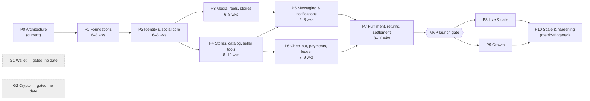
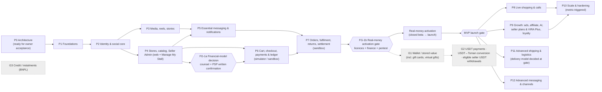

# 12 — Phased Development Roadmap

**v4:** the execution view of this roadmap (Claude-led, relative sizes, launch-readiness gate L) is **doc 20 §2**, which supersedes all team assumptions and durations here; scope and gates below are unchanged.

**Status:** Phase 0 **v3** — see **§v3 Final roadmap and approval gates** at the end, which supersedes the overview where they differ. **No phase starts without explicit written approval from the product owner.** Each phase ends with a demo, an exit review against the conditions below, and a GO/NO-GO for the next phase.

**Team assumption for durations (D-14):** 3 backend, 3 mobile, 1 web, 1 platform/DevOps, 1 QA, 1 product designer, 1 product manager; security and finance advisors part-time. Durations are indicative ranges, not commitments.

> **Audit F-11:** this team is not credible for the scope at these durations. The recommended re-baseline adds a second platform/SRE engineer, a payments-specialist backend engineer, a security lead and a second web engineer, plus moderation, finance-ops and support staff before the P2 and P7 exits. Running P3 and P4 in parallel assumes that re-baselined team; with the original team, use the sequential estimate.

**Detail level:** P0–P7 (the MVP) are specified with all ten required attributes. P8–P10 and the gated tracks are **outlines**; each receives a full ten-attribute specification at its own entry gate, when D-19/D-20/D-21 and real usage data exist.

## Overview

> **v2 detail — superseded by §v3 where different** (gates FG-1a/FG-1b, sandbox-first commerce, scenario-based staffing and durations in doc 17).

P3 and P4 can run in parallel after P2 (social vs. commerce streams); P5 needs both. Critical path: P1 → P2 → P4 → P6 → P7.

MVP = **P1–P7**: ≈ 11–14 months strictly sequential (sum of ranges), ≈ 9–12 months with P3 and P4 in parallel. Gated tracks G1 (wallet) and G2 (crypto) have no dates.

---

## P0 — Architecture (current)

> **v2 detail — superseded by §v3 where different** (gates FG-1a/FG-1b, sandbox-first commerce, scenario-based staffing and durations in doc 17).

| Item | Detail |
|---|---|
| Objectives | Understand the product; produce architecture; audit it |
| Scope | Documents 00–19 and evidence; no code |
| Exit conditions | **v3 meaning:** (1) UI verification done (doc 15); (2) every owner decision **recorded or classified** in the final register (doc 13 §0) — selections may remain OPEN if attached to a later gate; (3) ADR acceptance matrix complete (doc 05); (4) audit findings resolved or attached to named gates (doc 14); (5) owner’s written acceptance of Phase 0 |
| Dependencies | Access to the original ZIP; owner and counsel availability |
| Deliverables | Documents 00–19, screen inventory CSV, evidence folder (v3) |
| Acceptance criteria | Owner has reviewed every document; decisions recorded in doc 13 |
| Automated tests | Mermaid validation and cross-reference lint over the document set |
| Security requirements | Threat model (doc 08) reviewed by a security lead |
| Risks | R-01, R-02, R-15 |
| Rollback | n/a |

---

## P1 — Foundations

> **v2 detail — superseded by §v3 where different** (gates FG-1a/FG-1b, sandbox-first commerce, scenario-based staffing and durations in doc 17).

| Item | Detail |
|---|---|
| **Objectives** | A secure, observable, deployable skeleton that every later phase builds on |
| **Scope** | Monorepo layout (backend, mobile, web, contracts, infra); CI/CD; IaC for dev/staging/prod; in-country dependency mirrors; PostgreSQL, Redis/Valkey, NATS, object storage, Vault; observability stack; module skeletons with architecture lint; OpenAPI + event schema tooling and generated clients; outbox + job queue framework; idempotency middleware; error model; feature flags & remote config & min-version gate; audit log; admin auth realm (WebAuthn/TOTP) and RBAC skeleton; design tokens + Flutter/React component foundations (RTL, Vazirmatn, Jalali, Persian digits); Flutter app shell with navigation (doc 09) and offline outbox scaffold; PSP simulator skeleton; runbook templates |
| **Dependencies** | Phase 0 accepted; P1-B1…B3 (doc 13 §0.5, v4): authorisation, ADR acceptance, repository + implementation environment; staging account by end of P1. (D-16 distribution is **not** a P1 dependency — signing set-up uses the Android debug/release keys and can add channels later.) |
| **Deliverables** | Running dev/staging; “hello” endpoint through edge→API→DB with traces; admin login with 2FA; app shell on Android (and iOS if D-16); tokens package; ADR-012/013 finalised |
| **Acceptance criteria** | One-command local env; PR pipeline < 15 min; deploy to staging from merge; restore drill passes on empty DB; architecture lint blocks a forbidden import; RTL golden tests run in CI |
| **Automated tests** | Lint/arch rules, outbox relay integration test (crash between commit and publish → no loss), idempotency middleware tests, admin auth tests |
| **Security requirements** | Secrets in Vault only; branch protection; signed images; SBOM; admin realm behind VPN; TLS everywhere; baseline WAF |
| **Exit conditions** | All acceptance criteria met; threat model reviewed for infra; on-call rota and paging working |
| **Risks** | Provider maturity (managed K8s, object storage); mirror setup complexity; team onboarding |
| **Rollback** | Infrastructure is reproducible from IaC; no user data yet |

---

## P2 — Identity & social core

| Item | Detail |
|---|---|
| **Objectives** | Users can sign up, build a profile, follow, post images, comment, like, report |
| **Scope** | OTP auth, sessions/devices, TOTP optional; account deletion (grace); profiles (personal/creator); follow/requests/private accounts; blocks/mutes; image posts (carousel) with captions/mentions/hashtags; home feed v1 (following, chronological); likes, comments, saves/collections; notifications inbox + push (provider abstraction); report + moderation queue v1 + appeal; KYC L0/L1 (phone, national-ID match) if provider ready; Super Admin: users, content moderation |
| **Dependencies** | P1; SMS provider contract; D-13 (minimum age, policies v1); D-22 |
| **Deliverables** | Android build to internal testers; admin moderation console; privacy settings screens |
| **Acceptance criteria** | J1 & J2 end-to-end; OTP abuse limits verified; blocked user cannot see/DM/comment; deletion removes content within SLA; feed p95 < 300 ms at Tier A × 2 load |
| **Automated tests** | Authz relationship tests (block/private/close-friends matrix), OTP rate-limit tests, deletion propagation test across modules, upload abuse corpus (images) |
| **Security requirements** | OTP hashing, refresh rotation with reuse detection, device binding, username homoglyph protection, EXIF stripping |
| **Exit conditions** | 0 open HIGH security findings; moderation SLA tooling works; privacy review sign-off |
| **Risks** | SMS cost/fraud; moderation staffing; spam on launch |
| **Rollback** | Flags per feature; app versions behind min-version gate; data migrations expand-only |

---

## P3 — Media, reels, stories, creator studio, explore

| Item | Detail |
|---|---|
| **Objectives** | Short-video and stories experience with reliable processing and delivery |
| **Scope** | Resumable uploads; transcoding pipeline (HLS ladder, thumbnails); CDN signed URLs; reels player & feed; stories (24 h, viewers, close friends, highlights, archive, basic stickers); creator studio: media picker, crop, drafts, offline drafts; explore v1 (popular + category); media moderation hooks (pHash, classifier); admin: posts/videos & stories consoles |
| **Dependencies** | P2; CDN and object storage contracts; D-21 (classifier vendor/self-host) |
| **Deliverables** | Reels & stories in beta build; media SLO dashboards |
| **Acceptance criteria** | NFR-05 met at Tier A × 2; failed uploads resume; reel start-up time p90 < 1.5 s on 4G in-country; story expiry accurate ±1 min |
| **Automated tests** | Malformed video corpus; transcoder sandbox has no egress; signed-URL expiry; story expiry job; offline draft persistence |
| **Security requirements** | Quarantine → re-encode path mandatory; no original files served; private-account media requires signed URLs |
| **Exit conditions** | Egress cost per DAU measured and within budget envelope (D-14) |
| **Risks** | Egress cost; device codec fragmentation; moderation load |
| **Rollback** | Disable reels/story creation via flags; existing media remains served |

---

## P4 — Stores, catalog & seller tools

| Item | Detail |
|---|---|
| **Objectives** | Verified sellers can open stores and manage catalogue and inventory; buyers can browse |
| **Scope** | Seller onboarding (capability, KYC per D-09, Sheba binding with owner match, agreement acceptance per D-15); store profile, policies, shipping profiles & rates; category tree (admin); products, variants matrix, inventory with movements; product tagging in posts/reels; storefront, PDP, PLP, filters; search v1 (Postgres + Persian normalisation) then OpenSearch; seller staff & roles; mobile seller workspace (catalog parts); **Seller web console MVP** (catalog bulk, inventory) per D-23; admin: sellers, stores, products, categories, KYC queue |
| **Dependencies** | P2 (identity, KYC L1); D-09, D-15, D-23; KYC provider; maps provider for addresses |
| **Deliverables** | Seller onboarding live for pilot sellers; catalogue browsing in app |
| **Acceptance criteria** | J5, J11, J12 end-to-end; cross-tenant test suite 100% passing; Persian search quality checks (ی/ي, ک/ك, ZWNJ, digits) pass curated query set |
| **Automated tests** | RLS tests; inventory concurrency property tests; variant matrix validation; search normalisation tests |
| **Security requirements** | Sheba encrypted + blind index; staff role changes require owner TOTP; audit of KYC evidence access |
| **Exit conditions** | ≥ N pilot sellers onboarded (owner sets N) with complete catalogues; no tenant-isolation findings |
| **Risks** | Seller KYC friction; catalogue quality; bulk-upload expectations |
| **Rollback** | Store activation is admin-gated; products can be unpublished in bulk |

---

## P5 — Messaging & notifications

| Item | Detail |
|---|---|
| **Objectives** | Reliable 1:1 messaging including buyer↔store conversations; complete notification system |
| **Scope** | `vira-realtime` gateway; conversations (direct, store_support); message requests; text, images, product cards; receipts, typing; offline sync; push via abstraction + domestic fallback; notification preferences; message reporting; admin support view of store conversations (per D-11) |
| **Dependencies** | P2 (graph, blocks), P4 (product cards, stores); D-11 decided; D-18 push providers |
| **Deliverables** | Messaging in beta; realtime dashboards |
| **Acceptance criteria** | NFR-06; no message loss under gateway restarts and network flaps (chaos test); blocked users cannot message |
| **Automated tests** | At-least-once + dedupe tests; reconnect storm load test (Tier B connections × 1.5); authz tests |
| **Security requirements** | Encryption at rest; link-scanning; financial-detail warnings (IBAN/card patterns); retention per D-12 |
| **Exit conditions** | Load test passed; abuse tooling live |
| **Risks** | Privacy/legal model; spam; connection costs |
| **Rollback** | Disable new conversations by flag; history remains readable |

---

## P6 — Cart, checkout, payments & ledger

> **v2 detail — superseded by §v3 where different** (gates FG-1a/FG-1b, sandbox-first commerce, scenario-based staffing and durations in doc 17).

| Item | Detail |
|---|---|
| **Objectives** | Buyers can pay once for a multi-seller cart; every Rial is accounted for |
| **Scope** | Cart; quote (pricing, shipping per store; **no coupons** until finance signs off posting rules P1/P8, doc 06 §6.2a); checkout T1 with intent-guarded expiry and late-capture T7; one PSP adapter state machine (token, browser-mediated callback, verify, settle if required, inquiry, refund API if any) recorded in its own ADR; payment-unknown handling; ledger (chart of accounts, posting rules, invariants); PSP reconciliation R1; KYC-level purchase limits; risk rules v1; admin: payments, PSP config, ledger viewer, reconciliation; buyer screens J6 |
| **Dependencies** | P4; D-05 (PSP + settlement model), D-07 (commission, tax), D-06, D-34, D-35; signed PSP contract with sandbox; e-commerce trust requirements for PSP onboarding; **v2:** redesigned payment screens without in-app card capture (doc 15 V-01, doc 08 S-UI-01/02) and with USDT removed (V-02) |
| **Deliverables** | Checkout certified on the PSP sandbox for the FG-1a model; real money only after FG-1b (§v3) |
| **Acceptance criteria** | Full financial correctness suite (doc 11 §2) green; PSP simulator matrix green; sandbox certification by PSP; reconciliation shows 0 unexplained breaks over 14 days of beta |
| **Automated tests** | Property tests, concurrency tests, callback replay, late-success refund, recon synthetic reports |
| **Security requirements** | PSP keys in Vault; callback endpoint hardening; no WebView card entry; external penetration test of checkout & payments |
| **Exit conditions** | Finance sign-off on ledger design and recon; pentest HIGH/CRITICAL closed; kill switch “disable checkout” tested |
| **Risks** | PSP integration quirks; unclear licensing (D-05); reversal windows |
| **Rollback** | Kill switch; payments module flag; open intents resolved by inquiry jobs; ledger corrections only by reversing entries |

---

## P7 — Fulfilment, returns, refunds, settlement & payouts, support

> **v2 detail — superseded by §v3 where different** (gates FG-1a/FG-1b, sandbox-first commerce, scenario-based staffing and durations in doc 17).

| Item | Detail |
|---|---|
| **Objectives** | Close the commerce loop so sellers get paid correctly and buyers are protected |
| **Scope** | Seller order acceptance/rejection & SLA; shipments, tracking (carrier integration per D-24 or manual tracking codes); delivery confirmation & auto-confirm; partial returns with evidence; seller decision; disputes & admin arbitration; refunds (rail per D-08); settlement holds & release; seller balance & statements; payout requests with step-up; maker–checker batches (Paya/PSP payout); R2–R5 reconciliation; support tickets & knowledge base; reviews (text/photo); admin: orders, returns, disputes, withdrawals, support; seller web: orders & finance |
| **Dependencies** | P6; D-06, D-08, D-24, D-29; bank/PSP payout channel; **v2:** redesigned admin finance consoles (doc 15 V-06, doc 08 S-UI-03…05) and one policy set for hold/return windows (V-05) |
| **Deliverables** | **MVP release candidate**; closed beta → public launch gate |
| **Acceptance criteria** | J7, J8, J9, J13, J14, J21 end-to-end; payouts reconcile to the Rial for 30 days of beta; maker–checker cannot be bypassed (tests + pentest) |
| **Automated tests** | Return/refund multi-seller scenarios; payout failure; hold-release scheduler idempotency; authz matrix for finance roles |
| **Security requirements** | Payout cooling-off after Sheba/phone change; finance roles segregated; anomaly alerts on refunds/payouts; second pentest |
| **Exit conditions** | **MVP launch gate:** all CRITICAL/HIGH risks mitigated or accepted in writing; DR drill passed; runbooks rehearsed; support staffed; legal sign-offs L-01..L-05, L-07, L-08, L-10 |
| **Risks** | Fraud via returns; carrier integration gaps; finance operations load |
| **Rollback** | Disable payouts kill switch (balances keep accruing); manual payout path documented |

---

## P8 — Live shopping & calls (post-MVP)

> **v2 detail — superseded by §v3 where different** (gates FG-1a/FG-1b, sandbox-first commerce, scenario-based staffing and durations in doc 17).

| Item | Detail |
|---|---|
| **Objectives** | Live commerce and voice/video calls without destabilising the core |
| **Scope** | Media server + LL-HLS; host desk; product pins; live chat; purchases with attribution; emergency stop; scheduling & replay; WebRTC 1:1 calls with TURN; call history; admin live monitoring |
| **Dependencies** | P5, P6/P7; D-19; budget for egress |
| **Deliverables** | Live host desk and viewer in app; admin live monitoring with emergency stop; call screens; live cost dashboard |
| **Acceptance criteria** | 2 × expected peak viewers load test; emergency stop ≤ 5 s; call setup success ≥ 95% on in-country networks |
| **Automated tests** | Stream lifecycle, token revocation, chat rate limits, purchase-during-live inventory contention |
| **Security requirements** | Seller eligibility rules; ingest credential rotation; recording/retention per D-11/D-12 |
| **Exit conditions** | Cost per live-viewer-hour within budget |
| **Risks** | Cost, moderation in real time, network variability |
| **Rollback** | Flag off live/calls; no impact on commerce |

## P9 — Growth (post-MVP)

> **v2 detail — superseded by §v3 where different** (gates FG-1a/FG-1b, sandbox-first commerce, scenario-based staffing and durations in doc 17).

Ads/promote campaigns with ad-spend billing (G-FIN-01), affiliate links & creator commissions (D-20), coupons/gift cards/loyalty, recommendations v1, A/B experimentation, AI features (D-21), groups & channels, blue badge. Each item enters with its own mini-design review; money-moving items reuse the ledger and require finance sign-off. Acceptance, tests, security and rollback follow the same template as P6/P7.

## P10 — Scale & hardening (post-MVP, triggered by metrics)

Execute doc 04 §9 triggers: messaging cluster split, feed service, second PSP, search scaling, multi-site active/standby improvements, cost optimisation (codec ladders), chaos programme. Entry is driven by measured SLO/cost signals, not the calendar.

## Gated tracks (no dates)

> **v2 detail — superseded by §v3 where different** (gates FG-1a/FG-1b, sandbox-first commerce, scenario-based staffing and durations in doc 17).

| Track | Entry condition | First deliverable |
|---|---|---|
| G1 — Buyer wallet / stored value | **Activation** approved for D-03 (track itself retained by B-2) + licence/legal opinion + finance operating model | New Phase-0-style design review |
| G2 — Crypto / USDT | **Activation** approved for D-04 (track itself retained by B-2) + jurisdiction, sanctions, custody, provider, AML/travel-rule, key-management approvals | New Phase-0-style design review; separate threat model and independent security review |

---

## v3 — Final roadmap and approval gates (owner decisions B-2, B-3, financial gate)

### Principles

1. **Full-platform architecture, phased implementation** (B-2). Every long-term capability named by the owner is on this roadmap; none is deleted.
2. **No phase starts without the owner’s written authorisation.** Phase 1 is **not authorised**.
3. **Money is gated twice.** **FG-1a — financial-model decision** (platform collection vs PSP split, confirmed in writing by counsel and the PSP) must pass **before the P6 design freeze**, so that P6/P7 build the settlement design that will actually be used. P6/P7 are then built and certified on the PSP **simulator and sandbox**. **FG-1b — real-money activation** comes after P7. Neither gate blocks Phase 1.
4. Regulated or financially sensitive tracks stay **disabled by default** until their own design, legal, security and owner gates pass.
5. Durations depend on the selected budget scenario (doc 17 §6).

### Phase and track map

### Phase table (v3)

| Phase | Content (v3 changes in bold) | Entry gate | Depends on |
|---|---|---|---|
| P1 Foundations | **v4: scope and acceptance per doc 20 §5.3** (local stack + CI + one staging VM on the primary provider; K8s, Vault, full observability deferred to gate L); design tokens from the archive (D-26) | **Owner authorisation** + P1-B1…B3 (doc 13 §0.5) | — |
| P2 Identity & social core | As specified; **explicit, unticked consents and 6-digit OTP (doc 19 UC-5, UC-9)**; navigation per D-28 validation | Owner authorisation of P2 | D-12, D-13, D-18, D-22 |
| P3 Media, reels, stories | **`VideoProvider` adapter; managed video platform or self-hosted (ADR-009 amended)** | Owner authorisation | Video provider due diligence |
| P4 Stores, catalog, **Seller Admin web + “Manage My Stall”** | **Shared seller identity (doc 04 §10); ownership verification without in-app card capture (doc 19 UC-2)** | Owner authorisation | D-09, D-10 (L2), D-15, D-23 |
| P5 Essential messaging & notifications | **Seller notifications on mobile and web (doc 04 §10.5)** | Owner authorisation | D-11 |
| **FG-1a Financial-model decision** | Counsel opinion + PSP written confirmation of split capabilities; owner selects **Model 1 (platform collection)** or **Model 2 (PSP split)** (doc 06 §6.5); architect finalises the matching posting-rule set for finance review | Counsel, PSP, owner | F-01, D-05, D-06 (wording), D-07 (draft) |
| P6 Cart, checkout, payments & ledger | **Built and certified against PSP simulator/sandbox for the model chosen at FG-1a; PSP hand-off per doc 19 UC-1; ledger core** | **FG-1a passed** + owner authorisation | PSP selected; D-07 draft |
| P7 Orders, fulfilment, returns, settlement | **Sandbox only until FG-1b. Settlement scope follows the FG-1a model: Model 1 → holds, releases, payouts (maker–checker); Model 2 → split-report ingestion, seller PSP registration, receivables/clawback. Admin dual-control consoles (doc 19 UC-6, UC-7)** | Owner authorisation | D-08, D-24 |
| **L Launch readiness (v4, doc 20 §2)** | Hardening, load test, restore drill, monitoring/alerting, **independent human security audit and pentest**, named on-call arrangement, production hosting contract, store listings | Owner decision; specialists | P7 |
| **FG-1b Real-money activation gate** | Finance signs the posting rules and reconciliation; per-PSP adapter ADR from the signed contract; pentest of P6/P7 closed; licences/trust seals in place; final D-06/D-07/D-08/D-34 values; **v4:** named finance-operations and support people and ≥ 2 admin operators for dual control (doc 20 §1.4); independent security audit (gate L) | Counsel, PSP, finance, security, owner | FG-1a, D-06, D-07, D-08, D-34 |
| Real-money activation | Closed beta with real money → MVP launch | FG-1b passed + owner authorisation | Scenario B staffing recommended (doc 17 §8) |
| P8 Live shopping & calls | Live via provider or self-hosted; WebRTC calls; **in-call product sharing/purchase** (concept); **live auctions** (D-33, legal review); **virtual gifts only if G1 approved** | Owner authorisation (D-19, D-33) | Video provider, TURN/SFU |
| P9 Growth | Ads & ad billing, affiliate commissions, AI features, **seller plans & VIRA Plus, loyalty & rewards** (lucky wheel subject to legal review), verified (blue) badge programme, recommendations, A/B experimentation | Owner authorisation (D-20, D-21, D-30, D-32) | Ledger rules per product; tax treatment |
| P10 Scale & hardening | Metric-triggered (doc 04 §9) | Measured triggers | — |
| **P11 Advanced shipping & logistics** | Advanced logistics as drawn in the UI (express delivery, live rider tracking, carrier routing); **delivery model — own fleet, 3PL or carriers — decided at this gate** (D-29) | Owner authorisation | Delivery-model decision; location privacy (doc 08 S-UI-10) |
| **P12 Advanced messaging & channels** | Groups, broadcast channels, seller invoices in chat, notes | Owner authorisation | D-11 |
| **G1 Wallet / stored value** | Wallet balance, top-up, transfers, gift cards, virtual gifts, cashback as money | Legal/licence opinion, finance operating model, security review, owner written authorisation | FG-1b |
| **G2 USDT** | USDT payments, USDT↔Toman conversion **in both directions**, **eligible seller USDT withdrawals** | Separate Phase-0-style design (custody, key management, chain monitoring, exchange arrangement, AML/travel rule, sanctions), legal/licence opinion, independent security review, owner written authorisation | G1 (wallet ledger), ADR-019 interfaces |
| **G3 Credit / BNPL** | Instalment purchases | Lending licence or bank partnership, credit-risk design, owner authorisation | FG-1b |

### Separate approval gates (summary)

Phase 1 · each of P2–P7 · **FG-1a (model decision, before P6)** · **FG-1b (real-money activation, after P7)** · MVP launch · P8 · P9 · P11 · P12 · G1 · G2 · G3. Scale work (P10) is triggered by metrics but still requires owner authorisation for spend.
